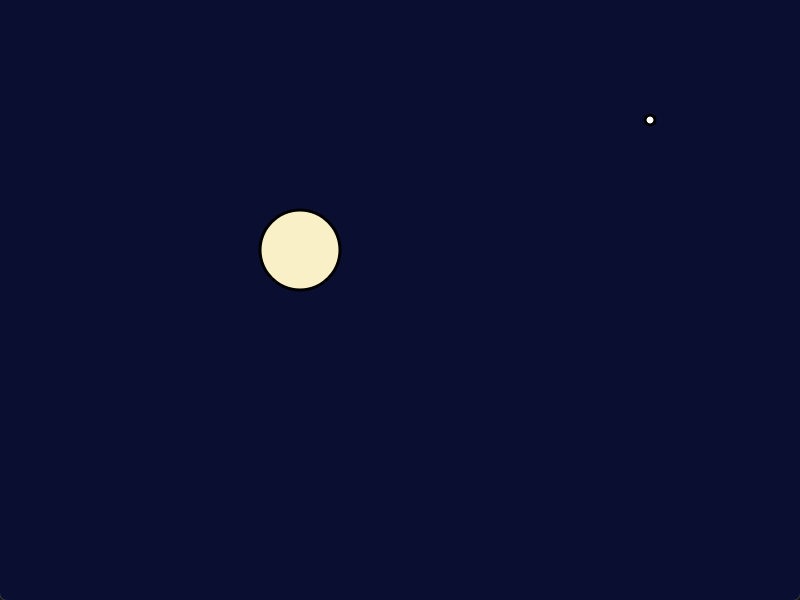

# Lesson 1: Your first window



**You will make:** a night sky with a moon that follows your mouse. Clicking prints where you clicked.

**You will learn:** the three functions every program has, how to draw a circle, how to read the mouse, and how to use the console.

**Time:** about 30 minutes.

**You need:** the CProcessing template, built and running once. [Your first program](Your-first-program) shows how to get it. When you see a circle follow your mouse, you're ready.

The finished program is in the repository as [Examples/Lessons/01_first_window/main.c](https://github.com/DigiPen-Faculty/CProcessing/blob/main/Examples/Lessons/01_first_window/main.c). Try writing it yourself first, in small steps, and use it to check your work.

---

## Step 1: Meet the three functions

Open `main.c`. At the bottom, `main` hands three functions to CProcessing:

```C
CP_Engine_SetNextGameState(game_init, game_update, game_exit);
CP_Engine_Run();
```

CProcessing then calls them for you:

* `game_init` runs **once**, when the program starts.
* `game_update` runs **every frame**, about 60 times a second.
* `game_exit` runs **once**, when the program ends.

You never call these yourself. Think of `game_update` as a flip book: each frame, you draw one page.

> **Try it:** add `printf("init\n");` to `game_init` and `printf("update\n");` to `game_update`, and add `CP_System_ShowConsole(TRUE);` as the first line of `main`. Run it. How many times does each one print in a second? (`printf` needs `#include <stdio.h>` at the top.)

## Step 2: Set up the window

Window settings go in `game_init`, because you only need to set them once:

```C
void game_init(void)
{
	CP_System_SetWindowSize(800, 600);
	CP_System_SetWindowTitle("Lesson 1: Your first window");
}
```

> **Try it:** change the size to a tall, thin window, then change it back.

## Step 3: Paint the sky

Each frame starts with the last frame's picture still on the screen, so the first thing `game_update` does is paint over it:

```C
CP_Graphics_ClearBackground(CP_Color_Create(10, 15, 50, 255));
```

A color has four numbers, each from 0 to 255: **red, green, blue, and opacity**. `(10, 15, 50)` is a very dark blue. Opacity 255 is solid.

> **Try it:** make the sky black, then orange, then find a color you like. Lesson 3 explains how colors work.

## Step 4: Draw a star

Shapes are drawn with the **fill** color, which stays set until you change it:

```C
CP_Settings_Fill(CP_Color_Create(255, 255, 255, 255));
CP_Graphics_DrawCircle(650.0f, 120.0f, 10.0f);
```

`DrawCircle` takes where the middle goes (x and y) and how wide the circle is.

**Where is (650, 120)?** The window's top left corner is (0, 0). **x grows to the right and y grows down.** So (650, 120) is near the top, right of the middle. This surprises almost everyone the first time: y is upside down compared to a graph in math class.

> **Try it:** draw five stars. Where would you put one in the bottom left corner of an 800 by 600 window?

## Step 5: Add the moon

The moon goes wherever the mouse is. Ask CProcessing where the mouse is, every frame:

```C
CP_Settings_Fill(CP_Color_Create(250, 240, 200, 255));
CP_Graphics_DrawCircle(CP_Input_GetMouseX(), CP_Input_GetMouseY(), 80.0f);
```

It moves because `game_update` runs again and again. Each frame it paints the sky, draws the star, reads the mouse, and draws the moon in the new place.

> **Try it:** delete the `ClearBackground` line and run it. What happens, and why? Put it back.

## Step 6: Say it with the console

Games need ways to look inside themselves. `printf` prints to the **console**:

```C
if (CP_Input_MouseTriggered(MOUSE_BUTTON_LEFT))
{
	printf("Clicked at (%.0f, %.0f)\n", CP_Input_GetMouseX(), CP_Input_GetMouseY());
}
```

`MouseTriggered` is true for **one frame**: the frame the button went down. (If it checked "is the button down" instead, a single click would print a dozen times.) [Input](Input) lists the others.

On Windows, `CP_System_ShowConsole(TRUE);` in `main` opens the console. On Linux and macOS, run your program from a terminal. [Debugging](Debugging) has more.

---

## Make it yours

Pick two or more.

1. **A better night.** Give the sky a color you chose on purpose. Add at least ten stars. Where does each one go?
2. **Phases of the moon.** Make the moon bigger while the left mouse button is held down. (Look at `CP_Input_MouseDown`.)
3. **A city.** Draw some buildings along the bottom with `CP_Graphics_DrawRect`. Note where `DrawRect` puts the rectangle: the middle, or a corner? Try `CP_Settings_RectMode`. [Coordinates and position modes](Coordinates-and-position-modes) explains.
4. **Your signature.** Show your name in the corner with `CP_Font_DrawText`.

## Check yourself

* What are the three functions, and how often does each run?
* Why does `CP_System_SetWindowSize` go in `game_init` and not `game_update`?
* In a window 800 pixels wide and 600 tall, where is (0, 0)? Where is (800, 600)?
* What does removing `ClearBackground` change, and why?
* What's the difference between `MouseTriggered` and `MouseDown`?

## Common mistakes

* **A shape in the wrong color.** Fill stays set. Set it *before* the shape you want it for.
* **Nothing appears.** Drawing happens in `game_update`. A `DrawCircle` in `game_init` is erased by the first frame's `ClearBackground`.
* **A number with a decimal point is passed to `int`, or the other way round.** Positions are `float`s, so write `650.0f`. Colors are `int`s, so write `255`.
* **No `printf` output.** On Windows, call `CP_System_ShowConsole(TRUE);`.

**Next:** [Lesson 2: Shapes and the coordinate system](Lesson-02-Shapes-and-Coordinates) (coming soon), or jump to [Lesson 3: Color](Lesson-03-Color).
