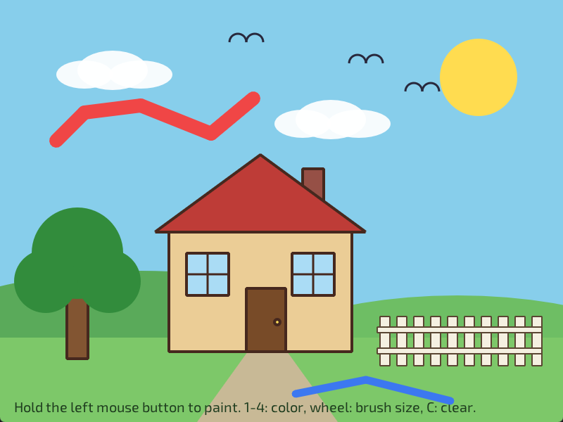
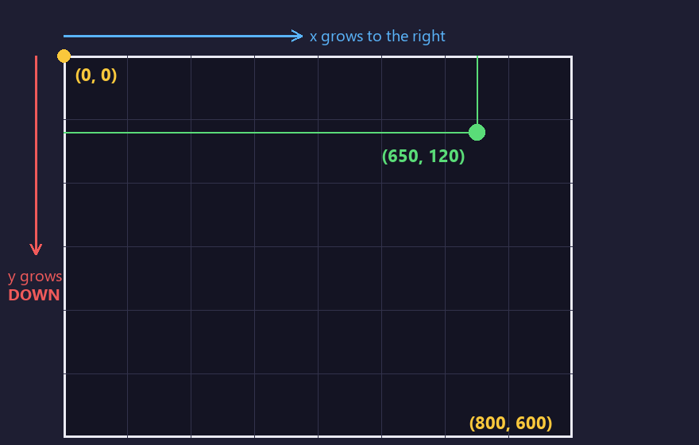
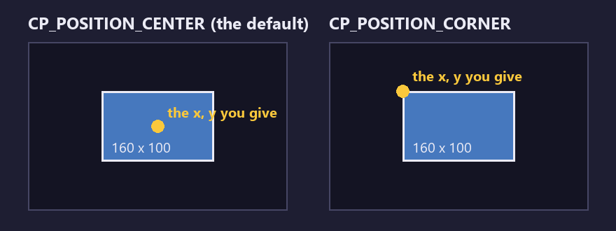

# Lesson 2: Shapes and the coordinate system



**You will make:** a little house with a tree, a fence, clouds and birds, all drawn from shapes, that you can paint on with the mouse.

**You will learn:** where every shape goes, what the position modes do, how fill and stroke work, how to let arithmetic and loops do the placing, and why a drawing stays on the screen.

**Time:** about 45 minutes.

**You need:** [Lesson 1](Lesson-01-Your-First-Window), or any program that draws a circle.

The finished program is in the repository as [Examples/Lessons/02_shapes/main.c](https://github.com/DigiPen-Faculty/CProcessing/blob/main/Examples/Lessons/02_shapes/main.c). It's longer than the lesson 1 program because a house has many parts, but every part is the same few ideas again. Try writing your own scene as you go, and use the finished program to check your work.

---

## Step 1: Where is everything?

Every position is a pair of numbers, **x** and **y**, in pixels:



* (0, 0) is the **top left** corner.
* **x** grows to the right.
* **y** grows **down**. A bigger y is lower in the window. (It's the other way from a graph in math class.)
* The bottom right corner is (width, height), which you can ask for with `CP_System_GetWindowWidth()` and `CP_System_GetWindowHeight()`.

> **Try it:** draw a circle at (0, 0) and another at the bottom right corner of your window. Why are they cut off? (Only the part of a shape inside the window is shown.)

## Step 2: The shapes

Here is everything CProcessing draws. Every shape takes its numbers as `float`s, so write `100.0f`.

```C
CP_Graphics_DrawPoint(x, y);                          // one dot
CP_Graphics_DrawLine(x1, y1, x2, y2);                 // a line between two points
CP_Graphics_DrawRect(x, y, width, height);            // a rectangle
CP_Graphics_DrawCircle(x, y, diameter);               // a circle
CP_Graphics_DrawEllipse(x, y, width, height);         // an oval
CP_Graphics_DrawTriangle(x1, y1, x2, y2, x3, y3);     // three corners
CP_Graphics_DrawQuad(x1, y1, x2, y2, x3, y3, x4, y4); // four corners, in order around the shape
CP_Graphics_DrawArc(x, y, diameter, startDegrees, sweepDegrees); // part of a circle's outline
CP_Graphics_DrawPie(x, y, diameter, startDegrees, sweepDegrees); // a slice of a circle
```

**The third number of a circle is how wide it is (the diameter), not the radius.** A circle of radius 50 is `DrawCircle(x, y, 100.0f)`. This is the most common surprise here.

The house in the lesson program is a handful of them:

```C
// The walls: a rectangle
CP_Graphics_DrawRect(left, top, 260.0f, 170.0f);

// The roof: a triangle takes its three corners
CP_Graphics_DrawTriangle(left - 20.0f, top, left + 130.0f, top - 110.0f, left + 280.0f, top);

// The doorknob: a small circle
CP_Graphics_DrawCircle(left + 154.0f, top + 128.0f, 8.0f);
```

A bird seen from the side is two arcs. An arc starts at an angle and goes clockwise by the sweep. **0 degrees points right and 90 points down** (because y goes down), so the top half of a circle starts at 180 and sweeps 180:

```C
CP_Graphics_DrawArc(x - 12.0f, y, 24.0f, 180.0f, 180.0f);
CP_Graphics_DrawArc(x + 12.0f, y, 24.0f, 180.0f, 180.0f);
```

> **Try it:** draw one of each shape in a row across the window. Which one was hardest to place? Try a pie with a sweep of 270, then of -90. (A negative sweep goes the other way.)

## Step 3: Where does the shape go?

You gave `DrawRect` an x and a y. Is that the rectangle's middle, or its corner? **It depends on the position mode:**



* `CP_POSITION_CENTER` (the **default**) puts the middle of the shape at your x and y.
* `CP_POSITION_CORNER` puts the top left corner there.

You choose one for rectangles and one for ellipses and circles:

```C
CP_Settings_RectMode(CP_POSITION_CORNER);
CP_Settings_EllipseMode(CP_POSITION_CORNER);
```

Lines, triangles, quads and points don't have a mode: their numbers are the points themselves.

Which mode is better? It depends on what you're drawing. Walls and a ground that must line up at an edge are easy in `CORNER`: "a rectangle 800 wide whose top left is (0, 480)". A window that is centered on a spot is easy in `CENTER`. The lesson program uses both, and **sets the mode it needs before each part**, because a setting stays until you change it:

```C
// The walls and door: measured from a corner
CP_Settings_RectMode(CP_POSITION_CORNER);
CP_Graphics_DrawRect(left, top, 260.0f, 170.0f);

// The windows: measured from their middles
CP_Settings_RectMode(CP_POSITION_CENTER);
CP_Graphics_DrawRect(left + 55.0f, top + 60.0f, 60.0f, 60.0f);
```

> **Try it:** draw a rectangle at (0, 0) in each mode. Where does each one go? Then draw a circle at the window's middle in each mode. [Coordinates and position modes](Coordinates-and-position-modes) has more.

## Step 4: Fill and stroke

A shape has two looks: its **fill** (the inside) and its **stroke** (the outline). You choose them before drawing:

```C
CP_Settings_Fill(CP_Color_Create(235, 205, 150, 255));       // the inside color
CP_Settings_Stroke(CP_Color_Create(70, 40, 30, 255));        // the outline color
CP_Settings_StrokeWeight(4.0f);                              // how thick the outline is
```

Or turn one off: `CP_Settings_NoStroke()` and `CP_Settings_NoFill()`. The clouds, the sun and the leaves in the lesson program have no stroke, which looks softer. The birds have no fill, because an arc has none anyway.

A line has no inside: it is *only* a stroke. So `NoStroke` makes lines invisible. And with `NoStroke` and `NoFill` together, nothing at all appears.

**Shapes drawn later cover shapes drawn earlier**, like layers of paper. That's why the lesson program draws the sky first, then the sun, the hills, the ground, the path, and the house last: back to front. The chimney comes before the roof so that the roof covers its bottom.

> **Try it:** swap the order of two shapes and see what changes. Make the windows `NoFill` and look at the house through them.

## Step 5: Let the computer do the arithmetic

Notice the numbers in `DrawHouse`: `left + 130.0f`, `top - 110.0f`. The house is drawn *from its top left corner*, with every part measured from it. To move the whole house, you change two numbers where it is called:

```C
DrawHouse(240.0f, 330.0f);
```

This idea, **measuring from one point**, saves a lot of work. So does measuring from the window's size, so a program keeps working at any size:

```C
// The sun, 120 pixels in from the right edge
CP_Graphics_DrawCircle(windowWidth - 120.0f, 110.0f, 110.0f);
```

And when you need many of the same shape, **a loop does the repeating and arithmetic does the spacing**. The fence is ten pickets, each 24 pixels further right:

```C
for (int i = 0; i < pickets; i++)
{
	CP_Graphics_DrawRect(left + i * 24.0f, groundY - 70.0f, 14.0f, 70.0f);
}
```

`i` goes 0, 1, 2, ... 9, so the pickets are at `left`, `left + 24`, `left + 48`, and so on. Change `10` to `20` and the fence grows.

> **Try it:** add a second row of windows by drawing them in a loop. Then make the fence's pickets alternate between tall and short. (Hint: `i % 2` is 0 for even `i` and 1 for odd `i`.)

## Step 6: The drawing stays

In lesson 1, every frame began by painting the whole window, so each frame started clean. The lesson 2 program does something different: **it draws the scene once, and then never clears**. What was drawn is still there next frame, because the window keeps its picture.

```C
void game_update(void)
{
	if (needsScene)
	{
		DrawScene();			// draws everything, starting with ClearBackground
		needsScene = FALSE;
	}
	...
}
```

That's what makes painting possible. While the left mouse button is held, each frame draws a thick line from where the mouse was last frame to where it is now:

```C
if (CP_Input_MouseDown(MOUSE_BUTTON_LEFT))
{
	CP_Settings_Stroke(brushColors[brushColor]);
	CP_Settings_StrokeWeight(brushSize);
	CP_Settings_LineCapMode(CP_LINE_CAP_ROUND);		// round ends make a smooth stroke
	CP_Graphics_DrawLine(CP_Input_GetMousePreviousX(), CP_Input_GetMousePreviousY(),
		CP_Input_GetMouseX(), CP_Input_GetMouseY());
}
```

A circle each frame would leave gaps when you move fast, because the mouse jumps many pixels between frames. A line joins the two spots. Pressing C draws the scene again, which paints over everything.

So there are two ways to make a program, and both are good:

* **Clear every frame and draw everything again** (lesson 1). Simple, and right for anything that moves.
* **Draw once and keep it** (this lesson). Right for paintings, trails and drawings that build up.

> **Try it:** put `CP_Graphics_ClearBackground(CP_Color_Create(135, 206, 235, 255));` as the first line of `game_update`. What happens to your painting? Why does the house disappear too?

---

## Make it yours

Pick two or more.

1. **More scenery.** Add a second tree, a moon, a car on the path or a dog. Give each its own function that takes a position, like `DrawTree`.
2. **Night.** Draw the same scene at night: a dark sky, a moon, stars in a loop, and yellow windows.
3. **A brick wall.** Draw rows of bricks, each row shifted half a brick. (A loop inside a loop: one for the rows, one for the bricks.)
4. **A checkerboard.** Eight rows of eight squares, alternating two colors. (`(row + column) % 2` is 0 or 1.)
5. **A face.** Build a face or a robot from shapes. Draw the eyes in a loop with a small change between them.

## Check yourself

* Where is (0, 0)? Does y grow up or down?
* `CP_Graphics_DrawCircle(100.0f, 100.0f, 50.0f)`: is 50 the radius or the diameter?
* What does `CP_POSITION_CORNER` change? Which shapes does it affect?
* Why does the roof get drawn after the walls, and the chimney before the roof?
* What does `CP_Settings_NoStroke()` do to a line?
* How would you draw eight circles in a row, 60 pixels apart?
* What does the lesson 2 program do differently from lesson 1 so that your painting stays?

## Common mistakes

* **A circle is twice as big as you wanted.** The third number is the diameter.
* **A rectangle is half its size off from where you expected.** Check the rect mode. And remember that a mode, like a color, **stays set**: if one function sets `CORNER` and the next one assumes `CENTER`, set it again.
* **A shape doesn't show.** Is its fill the same color as the background? Are `NoFill` and `NoStroke` both on? Did a later shape cover it?
* **A line doesn't show.** A line is only a stroke: it needs a stroke color, and `NoStroke` turns it off.
* **Positions that come out as 0.** `i / 2` with whole numbers rounds down. Use `i / 2.0f` when you need the fraction.
* **The painting disappears.** Something is clearing the window every frame.

**Next:** [Lesson 3: Color](Lesson-03-Color), or [Lesson 4: Input](Lesson-04-Input).
