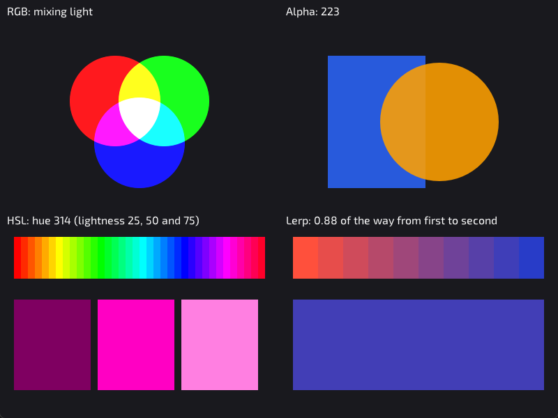
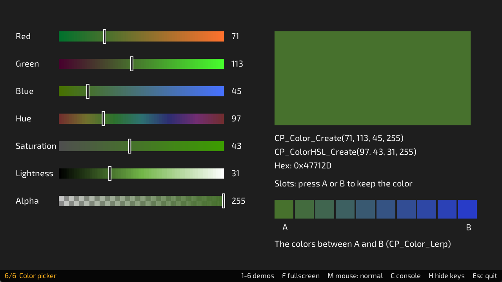

# Lesson 3: Color



**You will make:** a window with four small experiments on color. Three of them react to your mouse.

**You will learn:** how red, green and blue light mix, what alpha does, how to describe a color by hue, saturation and lightness, and how to find the colors between two colors.

**Time:** about 45 minutes.

**You need:** [Lesson 1](Lesson-01-Your-First-Window), or any program that draws a shape.

The finished program is in the repository as [Examples/Lessons/03_color/main.c](https://github.com/DigiPen-Faculty/CProcessing/blob/main/Examples/Lessons/03_color/main.c). The sliders in the picture below are the **Color picker** demo, number 6 in `Processing_Demos`. Keep it open while you read: it shows everything on this page.



---

## Step 1: Colors are mixed light

Every color on your screen is a mix of **red, green and blue** light. Each is a number from 0 (none) to 255 (full):

```C
CP_Color orange = CP_Color_Create(255, 160, 0, 255);
```

The three numbers are red, green and blue. (The fourth is alpha, in step 2.) Full red and some green, with no blue, makes orange.

Mixing light *adds*, which is not how paint works. Red and green light together make yellow. All three at full make white. All three at zero make black. By default, a new shape covers what's behind it. To see light add instead, change the blend mode:

```C
CP_Settings_BlendMode(CP_BLEND_ADD);
// ... draw a red, a green and a blue circle that overlap ...
CP_Settings_BlendMode(CP_BLEND_ALPHA);	// back to normal
```

> **Try it:** in the color picker, set red to 255 and green and blue to 0. Slowly raise green. Which colors do you pass through on the way to yellow?

## Step 2: Alpha is how see-through a color is

The fourth number is **alpha**: 255 is solid, 0 is invisible, and in between you can see what's behind:

```C
CP_Settings_Fill(CP_Color_Create(255, 160, 0, 128));	// half see-through orange
```

Alpha is why a shadow can darken the ground without hiding it. Shapes you draw first are *behind* shapes you draw later, so order matters.

In the lesson program, the mouse's left to right position becomes the alpha:

```C
float mouseAcross = CP_Input_GetMouseX() / CP_System_GetWindowWidth();	// 0.0 to 1.0
int alpha = (int)(mouseAcross * 255.0f);
```

Dividing the mouse position by the window width turns "pixels from the left" into "how far across, from 0.0 to 1.0". This trick shows up all over games, and it comes back in step 4.

> **Try it:** in the color picker, drag alpha down. What shows through the color?

## Step 3: Hue, saturation and lightness

Red, green and blue are how the screen works, but not how people think. Nobody says "a bit more red and a bit less blue" to mean "make it less purple". **HSL** is closer:

* **Hue** is the color's place on the color wheel, in degrees, 0 to 359. Red is 0, yellow 60, green 120, cyan 180, blue 240, magenta 300, and 360 is red again.
* **Saturation** is how vivid it is, 0 to 100. At 0 it's gray.
* **Lightness** is how bright, 0 to 100. 0 is black, 100 is white, and **50 is the pure color**.

```C
CP_ColorHSL hsl = CP_ColorHSL_Create(120, 100, 50, 255);	// pure green
CP_Color green = CP_Color_FromColorHSL(hsl);
```

You can draw only with a `CP_Color`, so `CP_Color_FromColorHSL` converts. `CP_ColorHSL_FromColor` goes the other way.

The hue strip in the lesson program is a loop that draws 36 boxes, 10 degrees further around the wheel each time:

```C
for (int i = 0; i < 36; i++)
{
	CP_ColorHSL hsl = CP_ColorHSL_Create(i * 10, 100, 50, 255);
	CP_Settings_Fill(CP_Color_FromColorHSL(hsl));
	CP_Graphics_DrawRect(20.0f + i * 10.0f, 40.0f, 10.0f, 60.0f);
}
```

Why use HSL? To make a darker version of a color, lower the lightness and leave the hue. To make a *matching* set of colors, keep saturation and lightness and change only the hue.

> **Try it:** in the color picker, set a color you like, then drag only *lightness* up and down. Then drag only *hue*. Which one would you use to make a button look pressed?

## Step 4: Lerp finds the colors in between

Say you want the sky to go from orange at the horizon to blue overhead. **Lerp** (short for linear interpolation) finds a color part of the way between two others:

```C
CP_Color a = CP_Color_Create(255, 80, 60, 255);
CP_Color b = CP_Color_Create(40, 60, 200, 255);

CP_Color middle = CP_Color_Lerp(a, b, 0.5f);	// halfway
```

The last number goes from 0.0 (all `a`) to 1.0 (all `b`). A loop gives a whole gradient:

```C
for (int i = 0; i < 10; i++)
{
	float t = i / 9.0f;		// 0.0, 0.11, ... 1.0
	CP_Settings_Fill(CP_Color_Lerp(a, b, t));
	CP_Graphics_DrawRect(20.0f + i * 36.0f, 40.0f, 36.0f, 60.0f);
}
```

**Careful:** `i / 9` with two ints is `0` for every `i` below 9, because C throws away the remainder. `i / 9.0f` keeps it. This is the most common mistake in this lesson.

Lerp isn't only for colors. It works for any number, and it's how things fade, glide and blend. The lesson program uses the mouse's across-ness from step 2 as `t`, so you slide between the colors by hand.

> **Try it:** in the color picker, press A, change the color, press B, and look at the ten boxes between them. Then pick two colors that are far apart on the color wheel, like red and green. Is the middle what you expected? (It's a dull olive, darker than both: lerp averages the red, green and blue numbers. Lerping hue with `CP_ColorHSL_Lerp` goes around the color wheel instead. Try both. [Using color](Using-color) has more on lerp.)

---

## Make it yours

Pick two or more.

1. **A sunset.** Change the Lerp corner's two colors to make a sunset, and draw it as a tall sky with a bar at each pixel row, or ten bands.
2. **A color wheel.** Draw 36 circles in a ring (you'll need `CP_Math_Sin` and `CP_Math_Cos`), each one 10 degrees of hue further around.
3. **Day and night.** Make the background color Lerp from a day sky to a night sky as `CP_System_GetSeconds()` goes up. How can you make it go back again, and repeat?
4. **Palette.** Choose four colors that go well together using only HSL, and draw four boxes in them. What did you keep the same?

## Check yourself

* What color is `CP_Color_Create(255, 255, 0, 255)`? Why?
* What does alpha 0 do? What does alpha 128 do over a white background?
* What hue is green? What's the lightness of a pure, un-washed-out color?
* What's wrong with `CP_Color_Lerp(a, b, i / 9)` for `i` from 0 to 9? How do you fix it?
* Which would you change to make a color darker: hue, saturation or lightness?

## Common mistakes

* **A color has no effect.** Fill stays set: set it *before* the shape you want it for. And remember `CP_Settings_Fill(...)` takes a color, not three numbers.
* **A strange color after the light-mixing code.** The blend mode stays set too. Set it back to `CP_BLEND_ALPHA`.
* **Colors out of range.** RGB and alpha are 0 to 255, hue is 0 to 359, saturation and lightness are 0 to 100. CProcessing clamps them (hue wraps around) rather than failing, so the mistake shows as a wrong color, not an error.
* **Integer division in a Lerp.** See step 4.

**Next:** [Lesson 4: Input](Lesson-04-Input).
