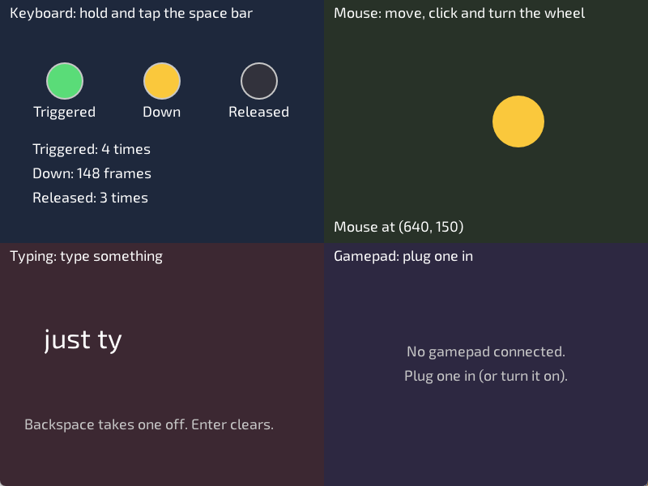

# Lesson 4: Input



**You will make:** a window with four panels that react to a player: one for the keyboard, one for the mouse, one for typing and one for a gamepad.

**You will learn:** the three questions you can ask about any key or button, how to read the mouse and its wheel, how to tell typing from key presses, and how to read gamepad sticks.

**Time:** about 45 minutes.

**You need:** [Lesson 1](Lesson-01-Your-First-Window). A gamepad is nice for step 5, but nothing else needs one.

The finished program is in the repository as [Examples/Lessons/04_input/main.c](https://github.com/DigiPen-Faculty/CProcessing/blob/main/Examples/Lessons/04_input/main.c). Run it first and play with every panel, then read how each one works.

---

## Step 1: Triggered, Down and Released

Your game runs about 60 frames a second, and a key press lasts many frames. So "is the space bar pressed?" has more than one meaning. CProcessing gives you three questions, and every key, mouse button and gamepad button answers all three:

| Question | True when | For |
|---|---|---|
| `CP_Input_KeyTriggered(KEY_SPACE)` | the key **went down this frame**: **one frame** per press | doing something once: jump, shoot, choose a menu item |
| `CP_Input_KeyDown(KEY_SPACE)` | the key **is held right now**: **every frame** while held | doing something continuously: walk, charge up, hold a shield |
| `CP_Input_KeyReleased(KEY_SPACE)` | the key **came back up this frame**: **one frame** | letting go: fire a bow, stop charging |

The first panel shows all three. Hold the space bar, and then tap it, and watch the counts:

```C
if (CP_Input_KeyTriggered(KEY_SPACE))
{
	triggeredCount++;
}
if (CP_Input_KeyDown(KEY_SPACE))
{
	framesDown++;
}
```

Hold the key for a second: "Down" counts about 60 frames, while "Triggered" goes up by exactly one. That is the whole difference.

One frame is far too short to see, so the lamps for Triggered and Released stay lit for a quarter of a second after they happen. The program remembers *when*, then draws the lamp while the time hasn't passed:

```C
triggeredLampUntil = CP_System_GetSeconds() + 0.25f;
...
DrawLamp("Triggered", x, y, CP_System_GetSeconds() < triggeredLampUntil, color);
```

> **Try it:** add `printf("triggered\n");` inside the `Triggered` check and `printf("down\n");` inside the `Down` check (and `CP_System_ShowConsole(TRUE);` in `main`). Tap the key, then hold it. How many lines of each?

## Step 2: The mouse

You met the mouse in lesson 1:

```C
float x = CP_Input_GetMouseX();
float y = CP_Input_GetMouseY();
```

The mouse buttons answer the same three questions. `MouseDown` is true while the button is held, so the second panel draws its ball solid while it is:

```C
if (CP_Input_MouseDown(MOUSE_BUTTON_LEFT))
{
	CP_Settings_Fill(CP_Color_Create(250, 200, 60, 255));
}
else
{
	CP_Settings_NoFill();
}
```

And `MouseTriggered` is the moment of the click, so that's where a ring starts. `MOUSE_BUTTON_RIGHT` and `MOUSE_BUTTON_MIDDLE` work the same way.

The wheel is different: `CP_Input_MouseWheel()` gives **how far it turned this frame**: positive for forward (up), negative for back, and 0 on most frames. The panel adds it to the ball's size:

```C
ballSize = CP_Math_ClampFloat(ballSize + CP_Input_MouseWheel() * 6.0f, 20.0f, 140.0f);
```

`ClampFloat` keeps the size between 20 and 140, so you can't scroll it to nothing.

A few more questions you can ask: `CP_Input_MouseMoved()`, `CP_Input_MouseDoubleClicked()`, `CP_Input_MouseDragged(MOUSE_BUTTON_LEFT)`, and how far it moved since last frame with `CP_Input_GetMouseDeltaX()` and `GetMouseDeltaY()`. Lesson 2's painting program used the *previous* position, `CP_Input_GetMousePreviousX()`, to draw a line from where the mouse was to where it is.

The ring uses what you know about frames. Each ring remembers its age, grows and fades as the age goes up (`CP_System_GetDt()` is how long the last frame took, in seconds), and is thrown away at half a second. [Moving with delta time](Moving-with-delta-time) explains `dt`.

> **Try it:** make a click with the **right** button start a ring too, in a different color. Then make the ball bigger while the right button is held.

## Step 3: Many keys

Keys have names: `KEY_A` to `KEY_Z`, `KEY_0` to `KEY_9`, `KEY_SPACE`, `KEY_ENTER`, `KEY_ESCAPE`, `KEY_UP`, `KEY_DOWN`, `KEY_LEFT`, `KEY_RIGHT`, `KEY_LEFT_SHIFT`, and more. [Types](Types/#CP_KEY) lists them all.

Each key is asked about on its own, so any number can be held at once. That's how a player moves diagonally: W and D are both Down. And you can offer a choice of keys with `||` ("or"):

```C
if (CP_Input_KeyDown(KEY_LEFT) || CP_Input_KeyDown(KEY_A))
{
	// move left
}
```

A modifier is just a key too. Holding shift makes something happen while held:

```C
if (CP_Input_KeyDown(KEY_LEFT_SHIFT))
{
	// run
}
```

> **Try it:** in the keyboard panel, make the "Down" lamp light for *either* the space bar or the Enter key.

## Step 4: Keys are not typing

A key and a typed letter are different things. `KEY_A` is a button on the keyboard. What the player *typed* depends on shift, caps lock, and the keyboard language: the same key can type `a`, `A` or `ä`. For a character in a name or a chat message, ask for the **typed text**:

```C
const char* typed = CP_Input_GetTypedText();
```

It returns the letters typed *this frame* as a string: usually empty, sometimes one letter, a few if the player types very fast. Add what it returns to your own text:

```C
const size_t length = strlen(typedText);
if (length + strlen(typed) < sizeof(typedText))
{
	snprintf(typedText + length, sizeof(typedText) - length, "%s", typed);
}
```

The `if` checks that the new letters still fit, because `typedText` is a fixed size. `snprintf` with the `%s` copies the new letters to the end.

Backspace and Enter aren't letters, so those are keys:

```C
if (CP_Input_KeyTriggered(KEY_BACKSPACE) && strlen(typedText) > 0)
{
	typedText[strlen(typedText) - 1] = '\0';
}
```

(`'\0'` is the end of a string, so putting one on the last letter cuts it off.) This version only handles plain letters. [Examples/text_input.c](https://github.com/DigiPen-Faculty/CProcessing/blob/main/Examples/text_input.c) also deletes accented letters correctly, finishes with Enter and draws a blinking cursor.

> **Try it:** make the text turn red when it gets longer than 10 letters.

## Step 5: The gamepad

A gamepad's buttons work like keys: `CP_Input_GamepadTriggered(GAMEPAD_A)`, `GamepadDown` and `GamepadReleased`, with `GAMEPAD_A`, `B`, `X`, `Y`, the shoulder buttons, `GAMEPAD_START` and the four `GAMEPAD_DPAD_` directions.

Before you read a gamepad, ask whether there is one:

```C
if (CP_Input_GamepadConnected())
{
	...
}
```

The **sticks** are not on or off. Each gives a `CP_Vector` with an x and a y, from -1.0 to 1.0:

```C
CP_Vector stick = CP_Input_GamepadLeftStick();
```

x is +1 for full right. **y is +1 for full UP**, which is the opposite of the screen, where y grows down. So the panel draws the dot at the stick's *minus* y:

```C
CP_Graphics_DrawCircle(x + stick.x * radius, y - stick.y * radius, 18.0f);
```

A stick that is let go of never rests at exactly the middle: it wobbles a little. If a game moved the player by that wobble, it would creep across the screen on its own. So CProcessing ignores a small area around the middle, called the **dead zone**, and gives exactly 0 inside it. Past the dead zone the number grows smoothly to 1. The faint ring in the panel is about where the dead zone ends (a bit over a quarter of the way out): move the stick slowly and see that the dot stays in the middle until you pass it.

The triggers are numbers too: `CP_Input_GamepadLeftTrigger()` and `GamepadRightTrigger()` give 0.0 (not pressed) to 1.0 (all the way), and the panel draws them as bars.

If more than one gamepad is plugged in, the functions that end in `Advanced` take a gamepad number, like `CP_Input_GamepadDownAdvanced(GAMEPAD_A, 1)`.

> **Try it:** if you have a gamepad, draw a ball and add the left stick's x and y to its position each frame (try `* 5.0f` so it moves fast enough to see). Let go of the stick: the ball stops. That's the dead zone at work. (Remember the y sign from above.)

## Step 6: Offering more than one way

Players have different keyboards, mice and gamepads, and some can use only one of them. Good games take input in several ways. A common pattern is to turn every kind of input into one *meaning*, and then use the meaning:

```C
CP_BOOL goLeft = CP_Input_KeyDown(KEY_LEFT) || CP_Input_KeyDown(KEY_A)
	|| CP_Input_GamepadLeftStick().x < -0.5f;
```

Everything after that line only asks "is the player going left?". [Lesson 5](Lesson-05-Moving-with-Vectors-and-Delta-Time) builds the whole thing for movement, and the [movement example](https://github.com/DigiPen-Faculty/CProcessing/blob/main/Examples/movement.c) already does it.

Never make a gamepad the *only* way to play, since a gamepad might not be plugged in.

---

## Make it yours

Pick two or more.

1. **More lamps.** Add a second key with its own three lamps, or make one set of lamps for a key you can change.
2. **A drag.** Make a circle you can pick up: click it (the mouse is *inside* it, which is `CP_Math_Distance` to the center less than the radius), then drag it with the button held, and drop it when the button is released. You need all three questions for the mouse button.
3. **A controls display.** Draw four boxes in a W-A-S-D shape that light up while those keys are held. Add the arrow keys on the right.
4. **A double click.** Show "Double click!" for a moment when `CP_Input_MouseDoubleClicked()` is true. (Use the same remember-when trick as the lamps.)
5. **Name entry.** Combine step 4 with a button: show what is typed in a box, and print the name to the console when Enter is pressed.

## Check yourself

* When is `KeyTriggered` true? `KeyDown`? `KeyReleased`?
* Which would you use to make a character jump? To make it walk while a key is held?
* Why do the Triggered and Released lamps stay lit for a quarter of a second?
* Which way is "up" for a stick's y? Which way is up on the screen?
* What is a dead zone, and what would happen without one?
* Why use `CP_Input_GetTypedText` and not `CP_Input_KeyTriggered(KEY_A)` to read a name?
* Why check `CP_Input_GamepadConnected()` first?

## Common mistakes

* **A jump that happens many times, or an on/off switch that flickers.** `KeyDown` is true on every frame the key is held. Use `KeyTriggered` for things that should happen once per press.
* **Movement that moves one step per press.** The other way round: `KeyTriggered` is true for a single frame. Use `KeyDown` for movement.
* **A press that is "missed".** `Triggered` and `Released` are true for only one frame. A check that doesn't run on that frame never sees it, for example when it is inside an `if` for a different game state.
* **A character flies the wrong way on the gamepad.** A stick's y is up-positive, but the screen's y is down-positive.
* **Comparing a stick to exactly 0.** Use a range, like `stick.x < -0.5f`.
* **Nothing happens without a gamepad.** Check `CP_Input_GamepadConnected()` and always offer a keyboard or mouse way too.

**Next:** [Lesson 5: Moving with vectors and delta time](Lesson-05-Moving-with-Vectors-and-Delta-Time).
