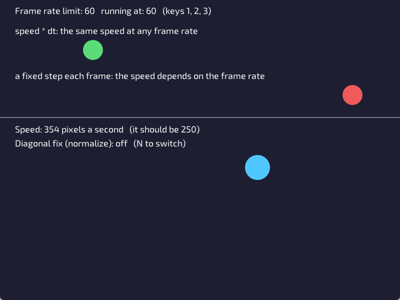

# Lesson 5: Moving with vectors and delta time



**You will make:** a window with two parts. The top is an experiment that shows why games measure time. The bottom is a player you move with WASD, the arrow keys or a gamepad, at the same speed in every direction.

**You will learn:** how to move something, why "5 pixels a frame" is a trap, what delta time is, how a vector holds a position or a direction, and why moving diagonally needs a fix.

**Time:** about 45 minutes.

**You need:** [Lesson 1](Lesson-01-Your-First-Window) and [Lesson 4](Lesson-04-Input) (you'll use `KeyDown`).

The finished program is in the repository as [Examples/Lessons/05_movement/main.c](https://github.com/DigiPen-Faculty/CProcessing/blob/main/Examples/Lessons/05_movement/main.c). Run it first and press 1, 2 and 3.

---

## Step 1: Moving is changing a position

Nothing in your game really moves. Each frame you draw a shape in a slightly different place, and your eyes see motion. The program keeps the place in a variable and changes it:

```C
float x = 30.0f;

void game_update(void)
{
	x += 5.0f;				// 5 pixels to the right, every frame

	CP_Graphics_ClearBackground(CP_Color_Create(30, 30, 50, 255));
	CP_Graphics_DrawCircle(x, 200.0f, 40.0f);
}
```

The amount a position changes in a unit of time is its **velocity**. Here the velocity is 5 pixels per frame. It works, so what's the trap?

> **Try it:** make a ball move across the window. Then make it turn round at the right edge instead of leaving (use `CP_System_GetWindowWidth()`, and a second variable that is +5 or -5).

## Step 2: The trap

Not every computer runs your game at 60 frames a second. A gaming monitor may run at 144, and a slow laptop at 30. At **5 pixels a frame**, your ball crosses the window more than twice as fast on the first, and half as fast on the second. Your game plays differently on every machine.

The top half of the lesson program shows it. Two balls cross the window. The red one moves a fixed step every frame. Press **1**, **2** and **3** to run the game at 15, 30 and 60 frames a second, and watch the red ball: it slows to a crawl at 15, while the green one doesn't change.

## Step 3: Delta time

The fix is to stop measuring in frames and **measure in seconds**. Give every speed in **pixels per second**, and each frame move by the speed times the time that frame took. That time is `CP_System_GetDt()`, "delta time", in seconds:

```C
const float speed = 300.0f;			// pixels per second

x += speed * CP_System_GetDt();
```

At 60 frames a second a frame takes about 0.0167 seconds, so a frame moves 300 x 0.0167 = 5 pixels. At 15 a second, a frame takes 0.067 seconds, so it moves 20 pixels, in fewer frames: the same distance every second. Check the **units**: pixels per second times seconds is pixels. That's the amount to move this frame.

The same goes for anything that changes over time: a timer counts down by `dt` each frame, and a spinning object turns by degrees per second times `dt`.

> **Try it:** in the lesson program, change `ballSpeed` to 600. Press 1, 2 and 3. Is the green ball the same speed at each? How long does it take to cross at 600?

## Step 4: Vectors

A position has two numbers, x and y. Moving them separately gets wordy, so CProcessing has `CP_Vector`, which holds both: a **vector** is an arrow with an x and a y.

```C
CP_Vector position = CP_Vector_Set(400.0f, 450.0f);
```

You can add, subtract and scale vectors:

| | |
|---|---|
| `CP_Vector_Add(a, b)` | the two arrows end to end: `(a.x + b.x, a.y + b.y)` |
| `CP_Vector_Subtract(a, b)` | the arrow from `b` to `a` |
| `CP_Vector_Scale(v, 2.0f)` | the arrow, twice as long |
| `CP_Vector_Length(v)` | how long the arrow is |
| `CP_Vector_Normalize(v)` | the same direction, with length exactly 1 |
| `CP_Vector_Distance(a, b)` | how far apart two points are |

A vector with a length of 1 is a **direction**. A direction times a speed is a **velocity**. So moving a player is three lines:

```C
CP_Vector velocity = CP_Vector_Scale(direction, playerSpeed);		// pixels per second
CP_Vector step = CP_Vector_Scale(velocity, CP_System_GetDt());		// pixels this frame
playerPosition = CP_Vector_Add(playerPosition, step);
```

> **Try it:** make a ball move toward the mouse at 200 pixels a second. The direction from the ball to the mouse is `CP_Vector_Normalize(CP_Vector_Subtract(mouse, ball))`. What does the ball do when it gets there? (It shakes. Why? How could you stop it?)

## Step 5: Which way?

The player's direction comes from the keys. Each held key adds to a vector:

```C
CP_Vector direction = CP_Vector_Zero();
if (CP_Input_KeyDown(KEY_A) || CP_Input_KeyDown(KEY_LEFT))
{
	direction.x -= 1.0f;
}
if (CP_Input_KeyDown(KEY_D) || CP_Input_KeyDown(KEY_RIGHT))
{
	direction.x += 1.0f;
}
// ... and the same for up and down. In a window y grows DOWN, so up is -1.
```

Hold D: `(1, 0)`. Hold W and D: `(1, -1)`. Now there's a bug. The length of `(1, -1)` is about 1.41, not 1. So going diagonally is **41% faster**! Press N in the lesson program and watch "Speed" while you hold W and D: 354 instead of 250.

The fix is `CP_Vector_Normalize`, which keeps the direction and makes the length exactly 1, so every direction is the same speed:

```C
direction = CP_Vector_Normalize(direction);
```

(When no key is held the vector is `(0, 0)`, which has no direction. Normalize gives `(0, 0)` back, so the player stands still.)

A gamepad stick is already a direction with a length from 0 to 1, where a half push is half the length and so half the speed. That's why sticks feel smooth. Its y is up-positive, so flip it, and `CP_Vector_Limit` keeps a stick that reaches into the corners from going past length 1:

```C
CP_Vector stick = CP_Input_GamepadLeftStick();
direction = CP_Vector_Limit(CP_Vector_Set(stick.x, -stick.y), 1.0f);
```

## Step 6: Stay in the window

Nothing stops a player at the edge unless you say so. `CP_Math_ClampFloat(value, min, max)` keeps a number in a range. Remember the position is the player's **middle**, so it can't go closer to an edge than half the player's size:

```C
const float half = playerSize / 2.0f;
playerPosition.x = CP_Math_ClampFloat(playerPosition.x, half, CP_System_GetWindowWidth() - half);
playerPosition.y = CP_Math_ClampFloat(playerPosition.y, half, CP_System_GetWindowHeight() - half);
```

> **Try it:** make the player come out of the left edge when it leaves the right one (wrap around) instead of stopping.

---

## Make it yours

Pick two or more.

1. **A chaser.** Add an enemy ball that moves toward the player at a slower speed than the player. Can you outrun it?
2. **Sprint.** Move faster while Shift is held, and show it by making the player a different color.
3. **Ice.** Keep a velocity vector between frames. Each frame add `direction * acceleration * dt` to it, and then shrink it a little (multiply by 0.98). The player speeds up and slides to a stop.
4. **Wrap around.** Leave the right edge and come in at the left. What about the corners?
5. **A trail.** Draw the last 20 places the player has been, getting smaller and fainter. (An array of 20 vectors, and a loop.)

## Check yourself

* Why does `x += 5.0f;` every frame move a ball at different speeds on different computers?
* What is `CP_System_GetDt()`? What are its units?
* Speed is 120 pixels per second and a frame took 0.02 seconds. How far does it move that frame?
* What is the length of the vector `(1, 1)`? What does `CP_Vector_Normalize` do to it?
* Why is `(1, -1)` a problem, and what fixes it?
* Why do you flip the y of a gamepad stick?
* Why is the player kept at least `half` its size from the edge?

## Common mistakes

* **Forgetting `dt`.** The movement works on your computer and is wrong on others. If a number changes every frame, ask whether it needs `* CP_System_GetDt()`.
* **Using `int` for positions.** At 60 frames a second, a speed of 100 pixels a second is 1.67 pixels a frame. An `int` throws away the 0.67 every frame and the speed comes out wrong. Positions and speeds are `float`.
* **Moving faster diagonally.** You forgot to normalize.
* **A jump after dragging the window.** Dragging a window stops the game for a moment, and the next frame's `dt` can be very large, so things leap. Many games limit it: `if (dt > 0.1f) dt = 0.1f;`.
* **A vector that is the wrong way up.** In a window, up is -y. On a stick, up is +y.

**Next:** [Lesson 6: Collision](Lesson-06-Collision).
