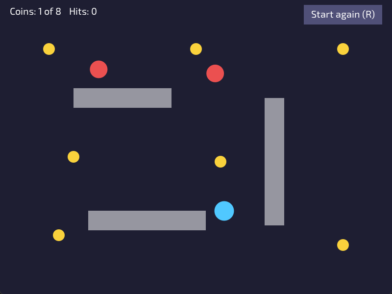

# Lesson 6: Collision



**You will make:** a small game. Collect every coin, keep out of the walls, and don't touch the red balls that bounce around.

**You will learn:** how a program can tell that two shapes touch, four checks that cover most games, and what to do once you know: collect, block and bounce.

**Time:** about 60 minutes.

**You need:** [Lesson 4](Lesson-04-Input) and [Lesson 5](Lesson-05-Moving-with-Vectors-and-Delta-Time). The player moves the way it did in lesson 5.

The finished program is in the repository as [Examples/Lessons/06_collision/main.c](https://github.com/DigiPen-Faculty/CProcessing/blob/main/Examples/Lessons/06_collision/main.c). The [collision example](https://github.com/DigiPen-Faculty/CProcessing/blob/main/Examples/collision.c) shows the same checks, with shapes that turn red when touched. Run both.

---

## Step 1: Touching is a question about numbers

Your computer doesn't see circles and walls. It has numbers: a position and a size for each thing. **Collision** is asking whether those numbers describe shapes that overlap. There are two separate jobs:

* **Detection:** are they touching? A function that answers yes or no.
* **Response:** what do we do about it? Collect a coin, stop at a wall, lose a life.

Games use simple shapes for this, circles and boxes (rectangles that don't turn), even when the picture is a fancy drawing. A circle around a character is a fine stand-in. This lesson has four checks. Each one is a short function that returns `CP_BOOL`.

A **box** in the program is stored by its middle, which is how CProcessing draws a rectangle by default, along with its width and height:

```C
typedef struct Box
{
	CP_Vector center;
	float width;
	float height;
} Box;
```

## Step 2: A point in a box

Is the mouse over the button? The point is inside the box when it is **between the left and right edges** *and* **between the top and bottom edges**. Four comparisons:

```C
CP_BOOL PointInBox(CP_Vector point, Box box)
{
	const float left = box.center.x - box.width / 2.0f;
	const float right = box.center.x + box.width / 2.0f;
	const float top = box.center.y - box.height / 2.0f;
	const float bottom = box.center.y + box.height / 2.0f;
	return point.x >= left && point.x <= right && point.y >= top && point.y <= bottom;
}
```

The middle plus or minus half the size gives each edge. `&&` means "and": all four must be true. The program uses this for the "Start again" button, which lights up while the mouse is over it and works when you click on it.

> **Try it:** draw a button in the middle of the window that changes color when the mouse is over it.

## Step 3: Circle and circle

Two circles touch when the distance between their centers is **no more than their two radii added together**:

```C
CP_BOOL CirclesTouch(CP_Vector centerA, float radiusA, CP_Vector centerB, float radiusB)
{
	return CP_Vector_Distance(centerA, centerB) <= radiusA + radiusB;
}
```

Picture two coins on a table. When their centers are exactly one radius plus the other radius apart, the edges just touch. Any closer and they overlap. The player uses this to take a coin, and to touch a ball.

**Careful: radius, not diameter.** The checks use the **radius**, but `CP_Graphics_DrawCircle` takes the **diameter**. The program keeps a radius for each circle and draws with `radius * 2.0f`. If you mix them up, a circle is drawn half as big as it behaves, and things seem to touch from a distance.

> **Try it:** change the coin radius to 40 but leave the drawing at 12 * 2. Collect a coin from afar. Then fix it.

## Step 4: A circle and a box

This is the one that surprises people, but the idea is neat. Find the **point of the box that is closest to the circle's center**. If that point is inside the circle, they touch.

Finding the closest point is a clamp: take the circle's center and squeeze its x and y to be within the box's edges:

```C
CP_BOOL CircleTouchesBox(CP_Vector center, float radius, Box box)
{
	CP_Vector closest;
	closest.x = CP_Math_ClampFloat(center.x, box.center.x - box.width / 2.0f, box.center.x + box.width / 2.0f);
	closest.y = CP_Math_ClampFloat(center.y, box.center.y - box.height / 2.0f, box.center.y + box.height / 2.0f);
	return CP_Vector_Distance(center, closest) <= radius;
}
```

If the circle's center is *inside* the box, the clamp changes nothing, the closest point is the center itself, the distance is 0, and they touch. If it's beside the box, the closest point is on a side. If it's near a corner, the closest point is the corner. One idea covers all three.

A box and another box (the check [collision.c](https://github.com/DigiPen-Faculty/CProcessing/blob/main/Examples/collision.c) calls `BoxesTouch`) touch when they overlap in **both** x and y.

> **Try it:** in the lesson program, draw the point `closest` as a small dot for one wall, and move the player around it. Where is it when the player is above the wall? At a corner?

## Step 5: Collect

Now the response. A coin is taken when the player touches it. The program keeps all the coins in arrays, and a flag for each one:

```C
CP_Vector coinPositions[COIN_COUNT];
CP_BOOL coinTaken[COIN_COUNT];
```

Every frame, a loop checks each coin that hasn't been taken:

```C
for (int i = 0; i < COIN_COUNT; i++)
{
	if (!coinTaken[i] && CirclesTouch(playerPosition, playerRadius, coinPositions[i], coinRadius))
	{
		coinTaken[i] = TRUE;
		coinsTaken++;
	}
}
```

The flag matters. Without it, the player would take the same coin on every frame it touches it, and the score would race up.

The same shape of loop works for anything: bullets against enemies, the player against pickups. **Arrays and loops let you add a ninth coin by changing one number.**

## Step 6: Block

A wall should stop the player. A simple way is to try each step, and not take it if it would end inside a wall:

```C
CP_Vector next = *position;
next.x += move.x;
if (CanBeAt(next, radius))
{
	position->x = next.x;
}
```

`CanBeAt` is true when a circle at that spot is inside the window and touches no wall. The program does it **one direction at a time**, across first and then down:

```C
// across
next = *position;  next.x += move.x;
if (CanBeAt(next, radius)) { position->x = next.x; }
// then down
next = *position;  next.y += move.y;
if (CanBeAt(next, radius)) { position->y = next.y; }
```

Why separately? If the player pushes diagonally into a wall and you checked the whole move at once, the whole move would be refused, and the player would **stick** to the wall. Checked apart, the step into the wall is refused and the step along the wall is allowed: the player **slides** along it, which feels right.

> **Try it:** change `MoveCircle` to check the whole move at once. Push into a wall diagonally. What happens? Change it back.

## Step 7: Bounce

A bouncing ball is a ball with a velocity that **turns round when it hits something**. Hitting a vertical wall turns round the across part of the velocity, and hitting a horizontal wall turns round the down part. Because `MoveCircle` does one direction at a time, it can say *which* one was blocked, and the ball flips just that part:

```C
MoveCircle(&ballPositions[i], CP_Vector_Scale(ballVelocities[i], dt), ballRadius, &blockedAcross, &blockedDown);
if (blockedAcross)
{
	ballVelocities[i].x = -ballVelocities[i].x;
}
if (blockedDown)
{
	ballVelocities[i].y = -ballVelocities[i].y;
}
```

The window's edges are walls too (`CanBeAt` checks them), so the same two lines bounce a ball off the window and off the boxes. And the player and the balls use the **same** `MoveCircle`: write it once, use it for everything.

When the player touches a ball, the player goes back to the start and the hit counter goes up.

## Step 8: When it goes wrong

Collision checks run once a frame, so a fast, thin thing can **jump over** a wall between two frames, because on neither frame was it touching. This is called *tunneling*. It happens when speed times `dt` is bigger than the wall is thick, for example after a long frame when you drag the window. Two fixes: keep walls thicker than a frame's step, and limit `dt` (lesson 5).

---

## Make it yours

Pick two or more.

1. **Lives.** Give the player three lives. Each hit costs one, and the game ends when they're gone. (You'll want to remember a `gameOver` flag, and lesson 9 turns that into game states.)
2. **A moving wall.** Make one wall slide up and down. What happens if the player is in the way?
3. **Coin values.** Make the coins different sizes, and worth their size in points.
4. **A goal.** Add a door at one side that only opens, drawing differently, once every coin is taken. What check tells you the player went through it?
5. **A box player.** Make the player a rectangle. You need a box-against-box check, and a box-against-circle check for the coins and balls. (`CircleTouchesBox` will do the second.)

## Check yourself

* What is the difference between detecting a collision and responding to one?
* When do two circles touch? Is the check about radius or diameter, and what does `DrawCircle` want?
* How do you find the point of a box that is closest to a circle's center?
* Why does the program move the player one direction at a time?
* How does a ball know which part of its velocity to turn round?
* What is tunneling?

## Common mistakes

* **Things touch from a distance, or pass through each other.** Radius and diameter are mixed up, between the drawing and the check.
* **A box check is off by half a box.** The check assumes a box is stored by its middle, but it was drawn from its corner (or the other way round). Use one convention.
* **A coin is collected over and over.** There's no "taken" flag.
* **A player sticks to a wall.** The whole move was refused. Check one direction at a time.
* **A ball gets stuck inside a wall.** It was moved into the wall, and *then* checked. Check first, and only take steps that are allowed.
* **Fast things go through walls.** Tunneling: see step 8.

**Next:** Lesson 7: Images and animation (coming soon).
