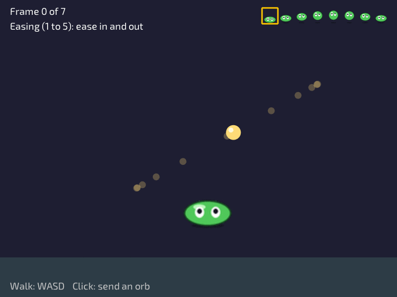

# Lesson 7: Images and animation



**You will make:** a slime that walks around and hops while it walks, and an orb that glides from the slime to wherever you click, in a style you can change.

**You will learn:** how to load and draw a picture, how to draw just one frame out of a sprite sheet, how to animate by choosing a frame from the time, how to flip a picture, and how easing makes movement feel alive.

**Time:** about 60 minutes.

**You need:** [Lesson 4](Lesson-04-Input) and [Lesson 5](Lesson-05-Moving-with-Vectors-and-Delta-Time). The slime walks the way the player did in lesson 5.

The finished program is in the repository as [Examples/Lessons/07_images/main.c](https://github.com/DigiPen-Faculty/CProcessing/blob/main/Examples/Lessons/07_images/main.c). The [sprite animation example](https://github.com/DigiPen-Faculty/CProcessing/blob/main/Examples/sprite_animation.c) shows the animation part on its own. Run both. The slime and its sprite sheet, `SlimeSheet.png`, are in the `Assets` folder of the project template.

---

## Step 1: Load once, draw many times

So far you have drawn with shapes. A game can also draw a **picture** from a file. Loading is the slow part (the computer reads the file, and unpacks it), so it happens **once**, in `game_init`, and the picture is kept in a variable:

```C
CP_Image slimeSheet;

void game_init(void)
{
	slimeSheet = CP_Image_Load("Assets/SlimeSheet.png");
}
```

The text in the quotes is a **path**: where the file is, starting from the folder your program runs in. The template puts pictures in `Assets`, so the path starts with `Assets/`. Loading never goes in `game_update`, because that would read the file again on every frame. When the game is done with the picture, you give it back in `game_exit`:

```C
void game_exit(void)
{
	CP_Image_Free(&slimeSheet);
}
```

The rule is the same for every file you load: **whoever loads it, frees it.**

> **Try it:** change the path to `Assets/Nothing.png` and run. What happens? (Nothing is drawn, and that's the sign: the file wasn't found. Check the spelling and the folder before you check anything else.)

## Step 2: Drawing a picture

```C
CP_Image_Draw(slimeSheet, 400.0f, 300.0f, 512.0f, 64.0f, 255);
```

The numbers are the **x and y of the middle**, the **width and height** you want it drawn at (not the size of the file, so you can stretch or shrink it), and the **alpha**, from 0 (see-through) to 255 (solid), as in lesson 3. A picture is drawn from its middle by default, and `CP_Settings_ImageMode(CP_POSITION_CORNER)` changes it, like `RectMode` in lesson 2.

If you draw `SlimeSheet.png` whole, you get a long strip of eight slimes, which is what the program shows in the top corner. It is a **sprite sheet**.

> **Try it:** draw the whole sheet in the middle of the window at twice its size. Then at half the alpha.

## Step 3: A sprite sheet is a flipbook

A character with several poses could be eight separate files, but then you'd load and keep track of eight things. Games put all the frames in **one image**, side by side, and draw **one piece** of it at a time. `SlimeSheet.png` has 8 frames in a row, each 64 pixels across and 64 down, so it's 512 pixels wide.

`CP_Image_DrawSubImage` draws part of a picture. After the size of the drawing, it takes the part you want, as the **corners in the picture's own pixels**: `u0, v0` for the top left and `u1, v1` for the bottom right.

```C
const float u0 = currentFrame * frameSize;		// frame 0 starts at 0, frame 1 at 64, frame 2 at 128...
const float u1 = u0 + frameSize;				// and it ends 64 later
CP_Image_DrawSubImage(slimeSheet, x, y, 128.0f, 128.0f, u0, 0.0f, u1, frameSize, 255);
```

The frame is 64 pixels across but is **drawn** 128 across, so it's twice as big. Frames are counted from **0**, like array indexes (the first one is frame 0, and the last of eight is frame 7).

> **Try it:** draw only frame 4 in the middle. Then draw frame 7 next to it.

## Step 4: Animation is choosing the frame from the time

A flipbook seems to move because the pages change at a steady speed. So: **keep time, and move to the next frame when enough has passed.** Lesson 5's `dt` again:

```C
frameTimer += dt;
const float frameDuration = 1.0f / framesPerSecond;		// 12 frames a second: each shows for 1/12 of a second
while (frameTimer >= frameDuration)
{
	frameTimer -= frameDuration;
	currentFrame = (currentFrame + 1) % FRAME_COUNT;
}
```

Each frame, the time is added up. When a frame's worth has gone by, take it away and go on to the next frame. The `%` (remainder) makes `currentFrame` go from 7 back to 0, so it loops. (The `while` rather than an `if` is for a slow frame that takes longer than one animation frame: the animation catches up.) Because it uses time and not frames, the slime animates at the same speed on every computer, which is the same lesson as lesson 5.

The program only does this **while the slime is walking**. When it stops, it goes back to frame 0, the slime resting on the ground:

```C
else
{
	currentFrame = 0;
	frameTimer = 0.0f;
}
```

> **Try it:** change `framesPerSecond` to 4, then to 30. When does it look like walking, and when like a flicker?

## Step 5: Facing left

The slime should face the way it goes. You don't need a second set of frames: ask for the frame's edges **the other way round**, giving `u1` first and `u0` second, and the picture is drawn flipped:

```C
if (facingLeft)
{
	CP_Image_DrawSubImage(slimeSheet, x, y, 128.0f, 128.0f, u1, 0.0f, u0, frameSize, 255);
}
```

`facingLeft` is a variable that remembers the last way the slime moved across. It's only changed when the slime is moving across, so going straight up doesn't turn it round.

> **Try it:** make the slime face the mouse instead of the way it's walking.

## Step 6: Easing

Now the orb. Click, and it glides from the slime to the mouse. The simplest way to move something from `start` to `end` is **lerp**, from lesson 3: `CP_Vector_Lerp(start, end, t)` gives the point `t` of the way there, with `t` from 0 (at the start) to 1 (at the end). Make `t` the **progress of the trip** in time:

```C
orbTimer += dt;
float progress = CP_Math_ClampFloat(orbTimer / tripTime, 0.0f, 1.0f);		// 0 at the start, 1 at the end
CP_Vector orb = CP_Vector_Lerp(orbStart, orbEnd, progress);
```

That moves at a steady pace, **linear** movement, and it looks mechanical: nothing in the real world starts at full speed or stops at once. **Easing** fixes this by bending the progress before it is used. An easing function takes the progress (0 to 1) and gives back a number (also 0 to 1) that is **how far along the path to be**:

```C
orb = CP_Vector_Lerp(orbStart, orbEnd, CP_Math_EaseInOutCubic(progress));
```

The orb is in the same place at the start and at the end, and the trip takes the same time. It's only the **pace** in between that's different. Press 1 to 5 in the program, click, and look at the **ghosts**: each is where the orb is at a regular beat in time. Wide gaps are fast and close gaps are slow.

| Easing | How it moves | Use it for |
|---|---|---|
| none (linear) | steady | scrolling, a loading bar |
| `EaseInQuad`, `EaseInCubic` | starts slow, ends fast | something leaving, or speeding up |
| `EaseOutQuad`, `EaseOutCubic` | starts fast, ends slow | something arriving, a menu sliding in, the most natural default |
| `EaseInOutQuad`, `EaseInOutCubic` | slow, fast, slow | moving between two resting places |
| `EaseOutBounce` | arrives, and bounces to a stop | something dropped, or popping in |

Cubic is a stronger version of quad: the same shape, more extreme. Easing isn't only for position. Ease a size to make something pop in (the capstone does this to a coin), ease an alpha to fade, ease a color with `CP_Color_Lerp`.

> **Try it:** in the program, make the trip 4 seconds long and compare all five easings by their ghosts.

---

## Make it yours

Pick two or more.

1. **A follower.** Draw a second slime that follows the first, a little behind. (It needs its own frame timer, or it will walk in step.)
2. **Fade out.** Make the orb fade out as it arrives, by easing its alpha. You need a color with an alpha, from lesson 3.
3. **A scene.** Draw a picture of your own behind the slime. Put a `.png` in `Assets`, load it in init and free it in exit.
4. **Jump.** When Space is pressed, make the slime hop up and come down over half a second, using `EaseOutQuad` for going up and `EaseInQuad` for coming down.
5. **Tint.** Make the slime flash when you press a key, by changing the alpha you draw it with for a tenth of a second.

## Check yourself

* Why is an image loaded in `game_init` and not in `game_update`?
* What is a sprite sheet, and why do games use them?
* In `CP_Image_DrawSubImage`, what are `u0`, `v0`, `u1` and `v1`, and in what units?
* How does the animation know when to go on to the next frame, and why does that not depend on the frame rate?
* How do you draw a frame flipped?
* What does an easing function change, and what does it leave the same?

## Common mistakes

* **Nothing is drawn.** The path is wrong, or the working folder isn't the one with `Assets` in it. Test with the file the lesson uses.
* **The game runs slower and slower, or stutters.** `CP_Image_Load` is in `game_update`.
* **The animation runs at a different speed on each computer.** It changes the frame every frame, instead of by time.
* **The slime shows two frames at once.** The corners are in the wrong units. They are pixels of the **sheet**, not of the window.
* **A frame is the wrong width.** `u1` is `u0` plus the width of one frame. Check `frameSize`.
* **An easing does nothing.** It was given a number outside 0 to 1, or the progress was never divided by the trip's duration.

**Next:** [Lesson 8: Sound](Lesson-08-Sound).
