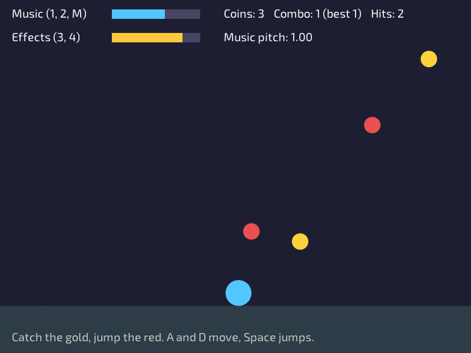

# Lesson 8: Sound



**You will make:** a catching game. Gold coins fall, and you catch them. Red rocks fall, and you jump them. Everything that happens makes a sound, and you control the volume.

**You will learn:** the difference between music and sound effects, how to load and play each, how groups give you separate volumes, how pitch adds variety, and when in your code a sound should be played.

**Time:** about 45 minutes.

**You need:** [Lesson 4](Lesson-04-Input) and [Lesson 6](Lesson-06-Collision). The game uses the distance check from lesson 6. You also need speakers or headphones.

The finished program is in the repository as [Examples/Lessons/08_sound/main.c](https://github.com/DigiPen-Faculty/CProcessing/blob/main/Examples/Lessons/08_sound/main.c). The [music and sounds example](https://github.com/DigiPen-Faculty/CProcessing/blob/main/Examples/music_and_sounds.c) lets you try each sound and volume without a game around it. The sounds (`Music.wav`, `Coin.wav`, `Jump.wav`, `Hit.wav`) are in the `Assets` folder of the project template.

---

## Step 1: Two kinds of sound

A game has two kinds of sound, and they are loaded differently:

* **Music** is long, and plays in the background. It would use a lot of memory if it was all loaded at once, so it is **streamed**: read from the file a little at a time as it plays. `CP_Sound_LoadStream`.
* **Sound effects** are short: a coin chime, a jump. They are loaded **whole**, so they start the instant you ask. `CP_Sound_Load`.

```C
CP_Sound music;
CP_Sound coinSound;

void game_init(void)
{
	music = CP_Sound_LoadStream("Assets/Music.wav");
	coinSound = CP_Sound_Load("Assets/Coin.wav");
}
```

Just like images in lesson 7, sounds are loaded **once**, in init, and freed in exit:

```C
void game_exit(void)
{
	CP_Sound_StopAll();
	CP_Sound_Free(&music);
	CP_Sound_Free(&coinSound);
}
```

`CP_Sound_StopAll` stops anything still playing before it is freed.

## Step 2: Playing a sound

The simplest way to play is `CP_Sound_Play(coinSound)`: once, at normal volume. The program uses the longer one, which says more:

```C
CP_Sound_PlayAdvanced(sound, volume, pitch, looping, group);
```

* **volume:** from 0 (silent) to 1 (full).
* **pitch:** 1 is normal. 2 is an octave higher and twice as fast, 0.5 an octave lower and half as fast. (The pitch and speed go together, like a record played too fast.)
* **looping:** `TRUE` starts over when it ends, for music. `FALSE` plays once.
* **group:** which group of sounds it belongs to. That's the next step.

The music starts once, in init, and loops for the whole game:

```C
musicInstance = CP_Sound_PlayAdvanced(music, 1.0f, 1.0f, TRUE, CP_SOUND_GROUP_MUSIC);
```

## Step 3: An instance is one play of a sound

`CP_Sound_PlayAdvanced` returns a **`CP_SoundInstance`**. A sound can be playing more than once at the same time (three coins caught at nearly the same moment are three plays of one `coinSound`), so the instance is a name for **this one play**. If you want to do something to the music later, keep its instance:

```C
CP_Sound_Pause(musicInstance);			// stops where it is
CP_Sound_Resume(musicInstance);			// carries on from there
CP_Sound_Stop(musicInstance);			// ends it
CP_Sound_IsPlaying(musicInstance);		// TRUE or FALSE
```

The program does this when you press **M**. Sound effects are over in a moment, so their instances are usually thrown away.

> **Try it:** press M a few times while the game is running. Does the music start from the beginning each time, or carry on? Then change `Pause` to `Stop` and compare.

## Step 4: Groups

Music and effects need different volumes: a player who finds the music too loud still wants to hear the coins. So every play belongs to a **group**, and each group has a volume of its own:

```C
CP_Sound_SetGroupVolume(CP_SOUND_GROUP_MUSIC, 0.6f);
CP_Sound_SetGroupVolume(CP_SOUND_GROUP_SFX, 0.8f);		// SFX means "sound effects"
```

In the program, 1 and 2 turn the music down and up, and 3 and 4 do the same for the effects. The two bars at the top show what each is set to. A game should always have a volume setting like this, because the right volume depends on the room and the player.

Notice the sound's **own** volume (the second number of `PlayAdvanced`) and the **group's** volume are multiplied. A sound played at 0.5 in a group at 0.5 comes out at 0.25.

## Step 5: When to play a sound

A sound should be played at the **moment something happens**, once. In the game, the places are:

* when Space makes the player jump,
* when the player touches a coin,
* when the player touches a rock.

```C
if (CP_Vector_Distance(things[i].position, player) <= playerRadius + thingRadius)
{
	things[i].active = FALSE;		// it's gone, so this can't happen again next frame
	...
	CP_Sound_PlayAdvanced(coinSound, 1.0f, pitch, FALSE, CP_SOUND_GROUP_SFX);
}
```

The classic mistake is playing a sound on every frame that something is true. If you play the coin sound while the player is touching a coin, and the coin lasts for ten frames, you hear ten overlapping sounds, a buzz. That's why the coin is **removed** the moment it's caught, as in lesson 6's "taken" flag: the event happens once.

## Step 6: Pitch for variety

If a player hears the same sound 200 times, it gets tedious. Two small ideas make it better:

**A little random pitch.** The program plays the jump and the hit at a pitch of 0.95 to 1.05, so no two sound exactly alike:

```C
CP_Sound_PlayAdvanced(sound, 1.0f, CP_Random_RangeFloat(0.95f, 1.05f), FALSE, CP_SOUND_GROUP_SFX);
```

**Pitch that means something.** Catching coins in a row (a **combo**) makes the chime go **higher** each time, so that a combo sounds like a run up a scale, and a miss breaks it:

```C
const float pitch = 1.0f + 0.07f * (float)((combo > 10 ? 10 : combo) - 1);
```

The first coin is pitch 1.0, the second 1.07, and so on, up to the tenth. The player hears how well they are doing. This is called **feedback**, and good games use sound for it all the time.

> **Try it:** change the 0.07 to 0.2. Is a combo more exciting, or does it get silly? Find a number you like.

## Step 7: A whole group's pitch

A rock hit also makes the **music** dip: it drops lower and slower, and then eases back to normal. A group has a pitch like it has a volume:

```C
musicDip = CP_Math_ClampFloat(musicDip - dt / 0.8f, 0.0f, 1.0f);
CP_Sound_SetGroupPitch(CP_SOUND_GROUP_MUSIC, 1.0f - 0.35f * CP_Math_EaseOutQuad(musicDip));
```

`musicDip` is set to 1 on a hit, and counts down to 0 over 0.8 seconds, and the easing from lesson 7 makes it recover smoothly. The pitch goes from 0.65 to 1. It's a small effect, but it makes a hit feel like a **hit**.

---

## Make it yours

Pick two or more.

1. **A miss.** Play a soft sound when a coin lands on the ground uncaught. Which of the three sounds would you use?
2. **Pitch with the combo.** Make the music itself play faster as the combo gets longer, and go back to normal when the combo ends.
3. **Pause.** Add a pause with P. Pause the music instance while paused, and stop the things from falling.
4. **Your own sounds.** Record or make a sound (a free tool like Audacity works), put the file in `Assets` and use it for the jump.
5. **A volume that is remembered.** Show the volume of the music as a percentage in the bar. Then make it so that M mutes by setting the volume to 0, and brings back the volume it had before.

## Check yourself

* What is the difference between `CP_Sound_Load` and `CP_Sound_LoadStream`? Which is for what?
* What is an instance, and when would you keep one?
* Why do music and sound effects go in different groups?
* Why would a sound played every frame that you touch a coin be a problem?
* Two ways to make a repeated sound less repetitive?
* What do you free, where, and when?

## Common mistakes

* **A sound is a buzz or a stutter.** It's played every frame, not once when the event starts.
* **The volume setting doesn't work.** The sound was played in a different group from the one you set. Use the group on the play, and the same group for the volume.
* **There is a pause in the game every time a sound plays.** A long sound was loaded in `game_update`. Load in init.
* **No sound at all.** Check the path (see lesson 7), your speakers, the group volume and the pitch (0 is silent). A sound that is stopped can't be paused or resumed: its instance is finished, so play it again.
* **The music is playing twice.** It was started in `game_update`, or in an init that ran again (see lesson 9). Keep the instance, and check `CP_Sound_IsPlaying` before starting it.

**Next:** [Lesson 9: Game states](Lesson-09-Game-States).
