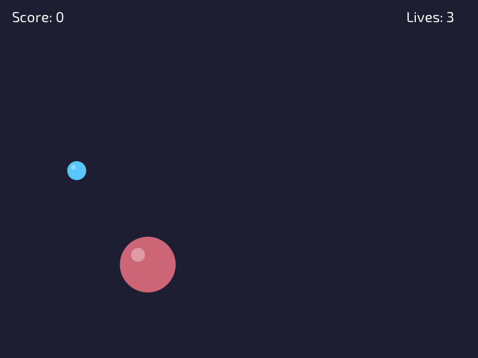

# Lesson 9: Game states



**You will make:** a complete game with four screens: a menu, the game, a pause and a game over. The game is **Pop!**: bubbles grow, and you click them before they burst.

**You will learn:** what a game state is, how to switch between them, why each has three functions, how states share values, and how to pause and restart without bugs.

**Time:** about 60 minutes.

**You need:** [Lesson 4](Lesson-04-Input) and [Lesson 6](Lesson-06-Collision) (a point inside a circle). Lesson 7's easing is used for a fade.

The finished program is in the repository as [Examples/Lessons/09_game_states/main.c](https://github.com/DigiPen-Faculty/CProcessing/blob/main/Examples/Lessons/09_game_states/main.c). The [game states example](https://github.com/DigiPen-Faculty/CProcessing/blob/main/Examples/game_states.c) is a different game with the same structure, and pauses with a flag instead. Play both.

---

## Step 1: A game is several programs

Every game you've played is a few different **modes**: a menu, the game, a pause, a game over screen. Each one draws different things and listens for different keys. The menu waits for Enter. The game moves bubbles. If they were all in one `game_update`, it would be a mess of `if` statements, and you could never tell which part of the code ran when.

A **game state** is one of those modes, with its own code. CProcessing has been using one all along: your `game_init`, `game_update` and `game_exit`. This lesson has four of them.

## Step 2: Three functions

Each state is three functions, and they run at different times:

* **init** runs **once**, when the state starts. Set things up: load files, reset values.
* **update** runs **every frame** while the state is on. Read input, change things, draw.
* **exit** runs **once**, when the state ends. Free what init loaded.

The program has `menu_init`, `menu_update` and `menu_exit`, and the same three for `play`, `pause` and `over`. They are listed together at the top of the file, called **declarations**, so any state can switch to any other, whatever order they are written in:

```C
void menu_init(void);
void menu_update(void);
void menu_exit(void);
...
```

The program starts at the menu:

```C
CP_Engine_SetNextGameState(menu_init, menu_update, menu_exit);
CP_Engine_Run();
```

## Step 3: Switching

To move to another state, ask for it. The menu does when Enter is pressed:

```C
if (CP_Input_KeyTriggered(KEY_ENTER))
{
	CP_Engine_SetNextGameState(play_init, play_update, play_exit);
}
```

The switch doesn't happen on the spot. At the **start of the next frame**, CProcessing runs `menu_exit`, then `play_init`, and from then on `play_update` every frame. So your current `update` finishes first, and a state can't end half way through its own function.

Because it waits, **the last request in a frame wins**, if two are made. That matters in the next steps.

> **Try it:** add a `printf` to each init, update and exit (the update one only once, so the console isn't flooded), and play through: menu, play, pause. What order do they come in?

## Step 4: Values that every state shares

A variable declared **outside** every function is a **global**. It lives as long as the program does, so it is how one state hands something to another. `score` is set in `play_update`, and shown in `over_update`. `bestScore` is kept across games:

```C
int score = 0;
int bestScore = 0;
```

A variable that only one state needs is a good thing to keep next to that state's code, like the bubbles. But **its value is only reset if init does it.** This is the most important sentence in this lesson. The program doesn't reset the bubbles when the program starts. It does so in `play_init`:

```C
void play_init(void)
{
	for (int i = 0; i < BUBBLE_COUNT; i++)
	{
		bubbles[i].active = FALSE;
	}
	score = 0;
	lives = 3;
	...
}
```

That's why "play again" always starts a fresh game: **every value the game changes is set in init**. If you forget one, the last game's value leaks into the next, and the bug shows only the second time you play.

## Step 5: The play state

The game is a handful of bubbles, in a struct, each with a position and a radius. Each frame the radius grows by a **speed times `dt`** (lesson 5), and a click inside one (the distance from the mouse to the middle is no more than the radius, lesson 6) pops it for points, **more for a bigger bubble**. A bubble that reaches `burstRadius` costs a life. When `lives` reaches 0, the game asks for the game over state:

```C
if (lives <= 0)
{
	CP_Engine_SetNextGameState(over_init, over_update, over_exit);
}
```

New bubbles come faster as the score goes up, which is the whole difficulty curve.

## Step 6: Pause is a state too

Press P, and the game freezes. Pause could be a variable, as in the example, but there's something to learn in making it a state. Its update **doesn't change the game at all**: it draws it, then a dark cover and some words, and listens for P, R and M.

For it to draw the game, **drawing is in its own function**, `DrawGame`, that both `play_update` and `pause_update` call. This is a good habit anyway: update the game in one place, and draw it in another.

```C
void pause_update(void)
{
	DrawGame();
	// a dark cover, then the words...
	if (CP_Input_KeyTriggered(KEY_P))
	{
		CP_Engine_SetNextGameState(play_init, play_update, play_exit);
	}
}
```

Here is the catch. Going back to the game runs **`play_init`**, which sets up a **new game**. The bubbles vanish and the score goes to 0, so pausing would be a way to cheat out of a bad round. The program fixes it with a flag, `resuming`:

```C
// in play_update, when P is pressed
resuming = TRUE;
CP_Engine_SetNextGameState(pause_init, pause_update, pause_exit);
return;

// in play_init, right at the top
if (resuming)
{
	resuming = FALSE;
	return;		// carry on: don't reset anything
}
```

R and M in the pause menu set `resuming` back to `FALSE` before they leave, so those start a new game or go to the menu. The `return` after asking for the pause is on purpose too: it ends the frame so nothing else (like a bubble bursting) can change the game or ask for a different state, and leave `resuming` set when it shouldn't be.

Honestly, for a simple game a **flag** (`paused` as a TRUE or FALSE that `play_update` checks) is easier, and is what the [example](https://github.com/DigiPen-Faculty/CProcessing/blob/main/Examples/game_states.c) does. A separate state is better when the pause is a whole screen, with its own buttons, like an options menu. Now you know what both cost.

## Step 7: Restart

R in the game starts over. You'd think this would work:

```C
CP_Engine_SetNextGameState(play_init, play_update, play_exit);
```

but the state we want is the one **we're already in**, so CProcessing sees that nothing is changing and does nothing. The **Forced** version does it anyway, running `play_exit` and `play_init`:

```C
CP_Engine_SetNextGameStateForced(play_init, play_update, play_exit);
```

Use it when you want to restart the same state. That's the only difference.

## Step 8: A soft switch

Switching is sudden, and a sudden change is a little jarring. Each state sets `stateTime` to 0 in its init, and adds `dt` to it in its update, so it's the seconds since the state started. `DrawFadeIn` uses it to draw a black cover over everything that fades away over half a second, using lesson 7's `EaseOutQuad`:

```C
const float progress = CP_Math_ClampFloat(stateTime / 0.5f, 0.0f, 1.0f);
```

It is a small thing, but it makes the switches feel like they were meant.

---

## Make it yours

Pick two or more.

1. **How to play.** Add a state reached from the menu with H. It needs three functions, a declaration at the top, and a way back.
2. **Faster over time.** Make the bubbles grow faster the longer the game lasts. (Keep a timer in `play_init`, and add to it with `dt`.)
3. **Bubble types.** Make some bubbles gold: rarer, small, worth ten times as much.
4. **Pick a mode.** Put two buttons on the menu, "Easy" and "Hard" (lesson 6's point in a box), that change `growSpeed` and the lives.
5. **A countdown.** After the menu, the game starts with 3, 2, 1. Is it a new state, or part of play? What would each cost?

## Check yourself

* What are the three functions of a state, and when does each run?
* When does a switch to another state happen?
* How does a state hand a value to the next one?
* What goes wrong if play's init forgets to reset a value?
* Why does going back from the pause need a flag?
* When do you need `SetNextGameStateForced`?

## Common mistakes

* **The second game starts where the first ended.** Something isn't reset in init.
* **A state never changes.** `SetNextGameState` was asked to switch to the state it's in. Use the Forced version.
* **The program won't build: "undeclared" or "implicit declaration".** A state's functions are used before they're written, and aren't declared at the top.
* **Pausing starts a new game.** `play_init` runs when returning. Use a flag, or pause with a variable.
* **Things load again and again, or never free.** Loading in `update`, or an init without an exit to match it. Each state frees what it loads.
* **Two requests in one frame.** The last one wins. Use `return` after the one that matters.

**Next:** [Lesson 10: Capstone](Lesson-10-Capstone).
