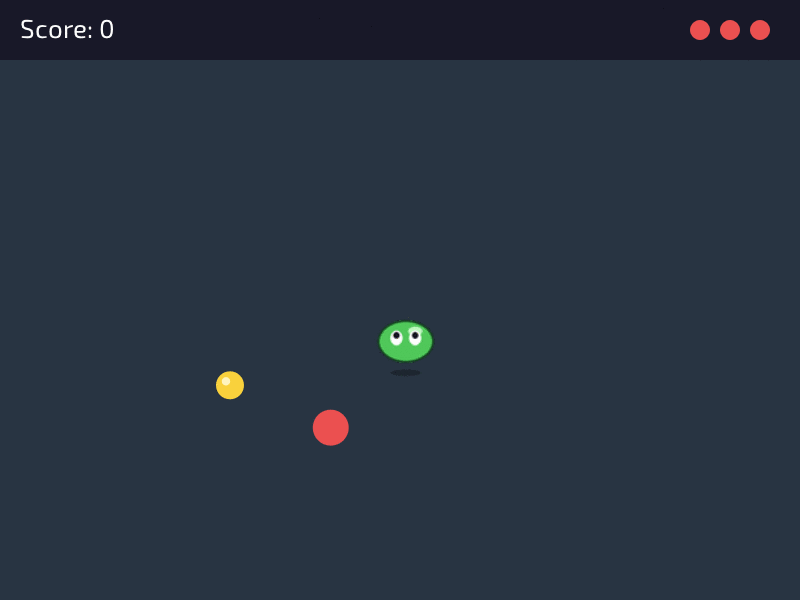

# Lesson 10: Capstone



**You will make:** a finished little game, **Slime Snacks**. You are a slime. Collect the coins, and keep away from the red balls, which get more crowded as you go. It has a menu, a pause, a game over, music and sound effects.

**You will learn:** how to build a whole game in layers, so that you always have something that runs, how the earlier lessons fit together, and how to tune and test a game until it feels right.

**Time:** about 90 minutes to read and play with, and as long as you like to make it your own.

**You need:** [Lessons 1 to 9](README). This lesson doesn't teach anything new. It uses everything.

The finished program is in the repository as [Examples/Lessons/10_capstone/main.c](https://github.com/DigiPen-Faculty/CProcessing/blob/main/Examples/Lessons/10_capstone/main.c). It is about 500 lines, and **you have seen every kind of line in it before**. Run it first, play it for a minute, and then read this page with the code open next to it.

---

## Step 1: Say what the game is

Before writing code, write the game in a few sentences:

> You are a slime in an arena. A coin is somewhere. Touch it to score, and another appears. Red balls bounce around, and every four coins there's another. A ball costs a life, and you have three. Coins in a row are a combo, and a combo is worth more.

Notice what's in there: **things** (a slime, a coin, balls), **rules** (touch a coin, touch a ball), and **an end** (no lives left). If you can't say what your game is in a few lines, you're not ready to write it, and your game would never be finished. Small games get finished.

## Step 2: Build it in layers

The most important idea in this lesson. **Don't write the whole game, and then run it.** Build a **layer**, run it, and make sure it works before you add the next. At each step you have a game, a small one, that you can show. If a layer breaks, it's the code you just wrote.

1. **A window and a slime that moves.** Lesson 5: a position, a speed, `dt`, and a normalized direction. Keep it in the window (`CP_Math_ClampFloat`).
2. **A coin.** Lesson 6: the distance between the slime and the coin. When they touch, add a point and move the coin.
3. **Balls that bounce.** Lesson 6: a position and a velocity, and turn round at the edges.
4. **Lives.** A hit takes a life. At 0, for now, just print "game over" to the console.
5. **States.** Lesson 9: move what you have into `play`, and add a menu and a game over.
6. **The slime picture.** Lesson 7: replace the circle with the sprite and animate it.
7. **Sound.** Lesson 8: a chime for a coin, a thump for a hit, music.
8. **Polish.** Easing, a combo, the blink after a hit.

Layers 1 to 5 are the **game**. Layers 6 to 8 are what make it **feel** like a game. You can leave them for the end, and you should: a game with circles that plays well is better than a lovely one that doesn't.

> **Try it:** don't read the code yet. Make layers 1 and 2 on your own, in a fresh `main.c`, and see how far you get. Then compare with the finished program.

## Step 3: A tour of the finished program

| Part of the program | What it uses |
|---|---|
| `menu_update` shows a title, a hopping slime, and waits for Enter | lessons 4, 7 and 9 |
| `play_init` loads the slime and sounds, and **sets every value the game changes** | lessons 7, 8 and 9 |
| the slime's movement: normalized direction times speed times `dt`, kept in the arena | lessons 4 and 5 |
| the slime's animation: a frame timer, a flip when facing left | lesson 7 |
| the coin: a distance check, `PlaceCoin`, a pop-in with `EaseOutBounce` | lessons 6 and 7 |
| the balls: velocity, bounce at the edges, a new one every 4 coins | lessons 5 and 6 |
| `CollectCoin`: score, combo, a rising chime | lesson 8 |
| a hit: a life, a dip in the music, a blink | lessons 6, 8 and 9 |
| `over_update`: the title bounces in, the best score is kept | lessons 7 and 9 |
| pause with `P`, and music paused with it | lessons 4, 8 and 9 |

Here are four spots where the game makes a choice of its own, and why.

**Coins appear away from the slime.** A coin right on top of the slime is a free point, and one at the edge is unfair. `RandomSpot` keeps picking places until it finds one that's far enough from a point, in the arena:

```C
CP_Vector RandomSpot(CP_Vector away, float distance, float margin)
{
	CP_Vector spot;
	do
	{
		spot = CP_Vector_Set(CP_Random_RangeFloat(margin, windowWidth - margin), ...);
	} while (CP_Vector_Distance(spot, away) < distance);
	return spot;
}
```

A `do ... while` always runs the body at least once, then repeats if the spot was too close. The same function places the balls (far from the slime, so that a new ball can't appear on top of it).

**A hit gives you a moment to get away.** Without it, one ball sitting on the slime would take all three lives in the next 3 frames. After a hit, `safeTimer` is set to 1.6 seconds. It counts down by `dt`, and while it's above 0, balls can't hurt, and the slime is drawn blinking, half see-through every other twelfth of a second:

```C
if (safeTimer <= 0.0f && CP_Vector_Distance(slimePosition, ballPositions[i]) <= slimeRadius + ballRadius)
```

Games call this **invulnerability frames**. A "timer that counts down by `dt`" is one of the most useful tools in this course. The combo, the score bump and the music dip are the same idea.

**A combo has a timer.** `combo` goes up with every coin, and `comboTimer` is set to 2 seconds. If the timer runs out before the next coin, the combo goes back to 0. A coin is worth the combo, up to 5 points. The chime goes up with the combo, as in lesson 8.

**Each state frees what it loads.** The menu loads the sprite sheet (to hop on the title screen) and frees it in `menu_exit`. The play state loads its picture and sounds in `play_init` and frees them in `play_exit`. Nothing is loaded twice, nothing is forgotten, and when you close the window, the exit of the current state runs, so closing during a game is clean. That's "whoever loads it frees it", from lesson 7.

## Step 4: Tuning

Look at the numbers at the top of each section: `slimeSpeed = 270`, `ballRadius = 18`, `safeTime = 1.6`, the 4 coins to a new ball, the speeds 140 to 220. **They are not right because someone worked them out. They were changed, and played, until the game felt good.** That is the job after the code runs, and it takes longer than writing the code.

Keep these numbers in named constants (not buried in the middle of a function), so that you can find and change them. And change **one thing at a time**:

* Too easy? Faster balls, or a ball every 3 coins, or a shorter `safeTime`.
* Too hard? The opposite. Or a smaller ball.
* Boring in the first ten seconds? Start with two balls. Boring after a minute? Add something new at 20 coins.

> **Try it:** change one number and play for a minute. Write down what changed in how it feels. Then change it again by a lot. Games are learned by playing them.

## Step 5: Testing

You've written it, and it works. Now try to break it, **on purpose**, as a player who doesn't read the instructions would:

* **Play twice.** Does the second game start like the first? (If not, something isn't reset in init. This is the number one bug.)
* **Pause and unpause** a lot, and during a hit. Does the music come back?
* **Go to every edge and corner** of the window, with the slime and the balls.
* **Die with a combo going.** Is the combo 0 at the start of the next game?
* **Mash every key** at once, on every screen.
* **Close the window** in the menu, in play, in the pause and on the game over.

When something is wrong, **find out what is true, rather than guess**. Print the values with `printf`, or draw them: a thin circle around the slime and the balls shows you exactly what the collision check sees.

---

## Make it yours

This is the real challenge: **change this game until it's yours.** Pick at least three, in this order of difficulty.

1. **Retheme it.** A different character and color scheme, a different name and menu text, your own sounds. Nothing about how it works has to change.
2. **A power-up.** A star that appears now and then, and makes you safe for five seconds. (You have the timer already.)
3. **Coins with value.** Coins of different colors, with different points, and a different sound each.
4. **A level two.** After 20 coins, the arena gets a wall (lesson 6's box and `MoveCircle`) that you and the balls must go round.
5. **A high score that's remembered.** Save the best score to a file with `fopen`, and load it at the start.
6. **A new game with the same pieces.** Use the structure (states, a player, things that move and collide, sound for feedback) for a different game: a shooter, a maze, a rhythm game.

## Check yourself

* Why build a game in layers, and what is the first layer?
* Which parts of this game would you keep if you made a different game?
* What problem do invulnerability frames solve?
* What is a timer that counts down by `dt`, and where does this game use one?
* Why is every value in `play_init` set there and not at the start of the program?
* What would you test first on a game you made?

## Common mistakes

* **Starting with the pretty parts.** Sprites and music first, and a game that isn't fun at the end. Make it fun with circles first.
* **Writing everything before running anything.** Run after every small piece.
* **The second game isn't like the first.** A value isn't reset in init.
* **Magic numbers.** `if (x > 723.5f)` in the middle of a function. Name it, and put it at the top.
* **A game that is never finished.** The idea kept growing. Finish the small game, then make a second one.

---

## What now?

You can make a game: window, shapes, color, input, movement, collision, pictures, sound and states. The rest is practice, and that means making more games, and finishing them. The [wiki](https://github.com/DigiPen-Faculty/CProcessing/wiki) has a page for every function when you want to know exactly what it does, and the demos and examples in the repository show more ideas. When something won't work, `printf` is still the best debugger you have.

Show someone your game. That's the best part.
