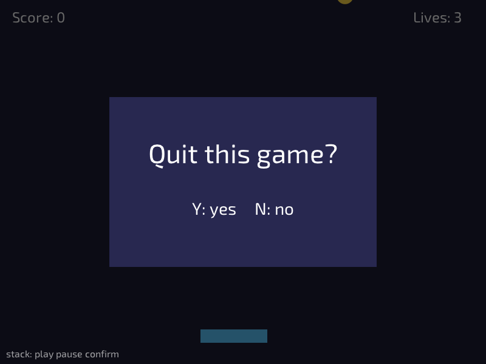

# Lesson 11: Your own state manager



**You will make:** the game states of lesson 9, **written by you**: a small stack of screens, with a menu, a game, a pause, and a "really quit?" box on top of the pause. The game is **Catch**: move the mouse to catch the falling stars.

**You will learn:** how a stack of states works inside, with arrays, structs and functions you already know; why `Push`, `Pop` and `SetNext` only ask for a change; why the top state gets all the input; and what the engine's game states do for you that your own can't.

**Time:** about 60 minutes. This lesson is an extra: you can make games without it.

**You need:** [Lesson 9](Lesson-09-Game-States) and [Lesson 10](Lesson-10-Capstone). There's almost no new C: arrays, structs and `if`. The one new idea is keeping functions in a struct, and you have been giving function names to `CP_Engine_SetNextGameState` since lesson 9.

The finished program is in the repository as [Examples/Lessons/11_state_manager/main.c](https://github.com/DigiPen-Faculty/CProcessing/blob/main/Examples/Lessons/11_state_manager/main.c). Run it first: P pauses, Q in the pause asks about quitting. Watch the line in the bottom left corner while you do.

---

## Step 1: Why build one

CProcessing has game states with a stack. You have used them: `SetNextGameState` clears the table and puts down a card, `PushGameState` puts a card on top, `PopGameState` takes it off. They work, and **for most games you should use them.**

So why build your own? Three reasons:

* **To understand it.** A stack of states looks like magic until you have made one. Then you know what a push really is, and why a pause doesn't run the game's exit.
* **To change the rules.** Maybe your game wants a different draw order, or a box that stops everything under it. When you have written the manager, it's yours to change.
* **Other tools do it.** Game engines have the same thing, often called a scene or state manager. Once you've written one, you know what to look for.

Everything in this lesson is about sixty lines of C, at the top of `main.c`.

## Step 2: CProcessing runs one state

Your manager runs **inside** a single CProcessing state. The program only uses the engine's `SetNextGameState` once, to start. Every frame, that one state hands the frame to the manager:

```C
void game_init(void)   { Screens_Set(&MENU); }
void game_update(void) { Screens_Update(); }
void game_exit(void)   { Screens_ExitAll(); }
```

To avoid mixing up the two, the manager's states are called **screens**.

## Step 3: A screen is a struct

A screen is four functions and a name:

```C
typedef struct Screen
{
	const char* name;
	CP_FunctionPtr init;
	CP_FunctionPtr update;
	CP_FunctionPtr draw;
	CP_FunctionPtr exit;
} Screen;
```

`CP_FunctionPtr` is CProcessing's name for "a function with no parameters that returns nothing": the kind that `game_init` is. A variable of that type holds a function, and you call it with `()`, like any function: `screen->update();`.

Each screen is one variable, made once at the top, with its functions:

```C
const Screen PAUSE = { "pause", NULL, pause_update, pause_draw, NULL };
```

`NULL` means "this screen has none", so a screen that doesn't need an init or an exit leaves it out. The manager checks before it calls (`if (screen->init)`), so you never call a function that isn't there.

There's one new thing here, compared with lesson 9: **update and draw are two functions.** Step 6 is about why.

## Step 4: A stack is an array and a number

```C
const Screen* stack[MAX_SCREENS];	// the screens, the bottom one first
int depth = 0;						// how many are on the stack
```

That's all a stack is. The array holds pointers to screens, the bottom first, and `depth` says how many of the places are in use. The top screen is `stack[depth - 1]`.

Putting a screen on top, and taking the top one off, are two small functions:

```C
void Screens_Enter(const Screen* screen)
{
	stack[depth] = screen;
	++depth;
	if (screen->init) screen->init();
}

void Screens_Leave(void)
{
	const Screen* screen = stack[depth - 1];
	if (screen->exit) screen->exit();
	--depth;
}
```

Everything else is built from these two. **Push** is Enter. **Pop** is Leave. **Set**, which clears the table, is Leave until nothing is left, and then Enter:

```C
while (depth > 0) Screens_Leave();
Screens_Enter(requested);
```

> **Try it:** add a `printf` to `Screens_Enter` and `Screens_Leave`, and play: menu, play, pause, quit. Compare the order with what lesson 9's states printed.

## Step 5: Asking, and doing

The screens call `Screens_Push`, `Screens_Pop` and `Screens_Set`, but those don't change the stack. They write down what was asked for:

```C
void Screens_Push(const Screen* screen)
{
	request = REQUEST_PUSH;
	requested = screen;
}
```

The change happens at the start of the next frame, in `Screens_Apply`, **the only function that changes the stack**. It's what CProcessing does, and for the same reasons:

* **A screen can't end half way through its own update.** If `play_update` pushed the pause on the spot, the rest of `play_update` would run with the pause on top. By waiting, every update finishes.
* **The stack doesn't change while it's being looped over.** Step 6's loop goes through the stack. Changing it in the middle is how a program ends up calling a screen that was just taken off.
* **The last request wins**, since there's one place to write it. That's lesson 9's "two requests in one frame" again, and now you can see why.

`Screens_Apply` also protects against two mistakes: a pop that would leave **no** screen (there'd be no top to update), and a push when the array is full. Both print a message and do nothing.

## Step 6: Update the top, draw them all

Here is the frame:

```C
void Screens_Update(void)
{
	Screens_Apply();

	stack[depth - 1]->update();

	for (int i = 0; i < depth; ++i)
	{
		stack[i]->draw();
	}
}
```

**Only the top screen updates.** Think about what this gives you for free:

* The game under the pause is **frozen**: its update never runs, so nothing moves.
* Only the top screen **gets input**. `P` in the pause is only seen by `pause_update`, so it doesn't also push another pause from the game. Keys can't reach a screen that isn't being updated.

**Every screen draws, bottom first.** The game draws the stars, then the pause draws a dark cover over them, then the box draws over that. That's why a pause looks like a card on top of the game.

And that's why **update and draw are separate functions.** Think about what would happen if the game drew in its update, as it did in lesson 9: its update doesn't run under the pause, so it wouldn't draw, and the pause would have nothing under it. With a draw function that is called every frame, the game's picture is made again each time, from the same values, so it looks frozen. A rule for this program: **update changes values, draw only reads them.**

The pause's `draw` is the "cover" of lesson 9, a see-through rectangle:

```C
void pause_draw(void)
{
	DrawVeil(150);
	DrawCenteredText("PAUSED", 240.0f, 80.0f);
	...
}
```

It doesn't build up to solid black, as a see-through rectangle drawn every frame would without clearing. The game's draw clears the window at the start of every frame, and then the veil is drawn once on top.

> **Try it:** comment out the `DrawVeil(150)` line in `pause_draw`. What's under the pause now, and what can you still do? Then change the 150 to 255. Why is it still the game's picture under the cover?

## Step 7: Seeing the stack

`Screens_DrawList` draws the names of the screens in the corner, bottom to top: `stack: play pause confirm`. It's four lines, and it's the best debugging tool in the program. When a state seems to do the wrong thing, the first question is *what's on the stack right now?*, and now you can see the answer.

## Step 8: Settings

Two draw functions that both set the fill color and the text size can upset each other: whatever the game's draw ended with is what the pause's draw starts with. `Screens_Update` wraps every draw in `CP_Settings_Save()` and `CP_Settings_Restore()`, so each starts with the settings it was called with, and anything it changes is put back. The engine does the same for its own states.

> **Try it:** remove the Save and Restore, and play. What changes? Which screens would have to set their own text size, color and alignment before drawing?

## What the engine does that this doesn't

The manager you wrote has the same ideas as the engine's, but not everything. What the engine's states give you in return for the extra code:

| | Your manager | CProcessing's states |
|---|---|---|
| A paused game stays visible | Every screen's draw is called every frame | Each state's picture is kept on a layer of its own, so a state can draw in its update |
| Drawing settings | Save and Restore around each draw | Each state has its own |
| What's under a box | Frozen, or you add a flag | `CP_Engine_SetGameStatePassThrough` chooses frozen or running, visible or hidden |
| Starting and ending | `Screens_ExitAll` when the program ends | The engine ends every state on the stack |

The first row is the big one. **The engine's layers are what let lesson 9 draw in `update` at all.** Without them, you need a separate draw function, which is how most game engines are written, and is why the screens here have one.

So when would you use your own? When you want a design that isn't the engine's (a different draw order, screens that draw themselves into a texture, ...) or when you want to know how it works. Otherwise, the engine's.

---

## Make it yours

Pick two or more.

1. **How to play.** Add a screen reached from the menu with H, and a way back. It needs its functions, a declaration at the top and a `Screen` variable. Should it be a `Set` or a `Push`?
2. **A box over a running game.** Add a field `CP_BOOL coverRuns` to the struct. When the screen on top has it set, `Screens_Update` updates the screen under it too. Make a "level up" box that the game keeps running under, as lesson 9 and the examples do with `CP_STATE_PASSIVE`. (What about input? The screen under it must not see keys.)
3. **A fade.** Give each screen the seconds since it began (an array next to the stack, set to 0 in `Screens_Enter`), and use it to fade the pause's cover in.
4. **Replace.** Write `Screens_Replace(screen)`: take off the top screen and put another in its place, in one request. When is that different from a Pop and a Push?
5. **Skip what you can't see.** A screen that covers everything (the menu) makes the draws under it a waste. Add a field `opaque`, and make the draw loop start at the top-most opaque screen.

## Check yourself

* What is a stack, in this program?
* What do `Screens_Push` and `Screens_Pop` do, and which function changes the stack?
* Why does the change wait until the next frame?
* Why does only the top screen get input, without any code that says so?
* Why are update and draw two functions here, and why didn't lesson 9 need that?
* What does the pause draw, and what's under it?
* What does `Set` do that `Push` doesn't?

## Common mistakes

* **The program crashes after a pop.** A pop with one screen on the stack leaves `depth` at 0, and `stack[depth - 1]` is no screen. `Screens_Apply` checks for it. If you change it, keep the check.
* **A screen vanishes the moment it is shown.** Its variable was made inside a function, and is gone when the function ends. Screens are made once, at the top of the file, so `&PAUSE` always points at something.
* **The game draws, but the pause shows nothing under it.** The game draws in its update, which doesn't run under the pause. Draw in the draw function.
* **Things in the pause move.** A value changes in a draw function. Draw only reads.
* **The text under the pause is the wrong size.** Settings leaked from one draw to the next. Keep the Save and Restore, or set what you use.
* **The stack changes in the middle of a frame.** Something called `Screens_Enter` or `Screens_Leave` directly. Ask with Set, Push and Pop.
* **Calling a function that's `NULL`.** Check `if (screen->init)` before calling.

**Next:** back to your own games. You have the tools. The [wiki](https://github.com/DigiPen-Faculty/CProcessing/wiki) has a page for every function.
