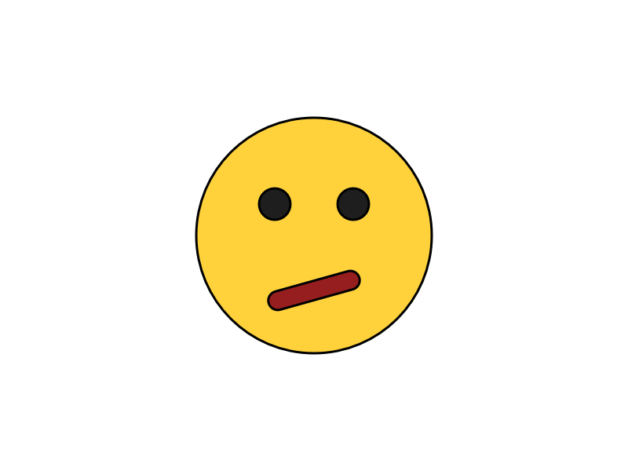

# Project 3: Turning and rounding shapes



Most shapes in a game don't sit still and square. A mouth smiles, an arm swings, a button has soft corners. This project builds a face and gives it a mouth that is rounded, tilted, and wobbling, and finds out on the way how *turning* works in CProcessing, since that is the part that surprises people.

**You will make:** a face with a rounded mouth that tilts and wobbles.

**You will learn:** how to round the corners of a rectangle, why turning a shape needs three lines around it, and how to make a number swing back and forth with `sinf`.

**Time:** about 40 minutes.

**You need:** the CProcessing template, built and running once ([Your first program](Your-first-program)). This project explains all it needs about turning. [Transforms](Transforms) is the page to read afterwards: it covers scaling, turning around other points, and a camera.

The finished program is in the repository as [examples/projects/03_turning_shapes/main.c](https://github.com/DigiPen-Faculty/CProcessing/blob/main/examples/projects/03_turning_shapes/main.c). The [rotation example](https://github.com/DigiPen-Faculty/CProcessing/blob/main/examples/rotation.c) turns shapes and sprites around any point, with helpers to copy.

---

## Step 1: A face with a rounded mouth

[CP_Graphics_DrawRoundedRect](Graphics/#CP_Graphics_DrawRoundedRect) is like `CP_Graphics_DrawRect`, with one more number: the **corner radius**, how round the corners are. Replace the code in `main.c` with this:

```C
#include "cprocessing.h"

void game_init(void)
{
	CP_System_SetWindowSize(800, 600);
}

void game_update(void)
{
	CP_Graphics_ClearBackground(CP_Color_Create(255, 255, 255, 255));

	// The head
	CP_Settings_Fill(CP_Color_Create(255, 210, 60, 255));
	CP_Graphics_DrawCircle(400.0f, 300.0f, 300.0f);

	// The mouth: x, y, width, height, corner radius
	CP_Settings_Fill(CP_Color_Create(150, 30, 30, 255));
	CP_Graphics_DrawRoundedRect(400.0f, 370.0f, 120.0f, 24.0f, 12.0f);

	// The eyes
	CP_Settings_Fill(CP_Color_Create(30, 30, 30, 255));
	CP_Graphics_DrawCircle(350.0f, 260.0f, 40.0f);
	CP_Graphics_DrawCircle(450.0f, 260.0f, 40.0f);
}

void game_exit(void)
{
}

int main(void)
{
	CP_Engine_SetNextGameState(game_init, game_update, game_exit);
	CP_Engine_Run();
	return 0;
}
```

The `(400, 370)` of the mouth is its **middle**, because a shape's position is its center unless you change that ([Coordinates and position modes](Coordinates-and-position-modes)). The eyes are drawn last on purpose. You will see why in step 3.

> **Try it:** change the corner radius, the last number of the mouth, to 0, then 4, then 12, then 30, then 60. What does the mouth look like each time? At 12, half the mouth's height, the short ends are exactly round. What happens to the corners when the radius is more than that?

A radius up to half of the shorter side (12 here) gives round corners. A bigger one stretches the corners into an oval.

## Step 2: Turn it, and watch it go wrong

To turn the mouth, `CP_Settings_Rotate` takes an angle in degrees and turns clockwise. Add it *before* the mouth is drawn:

<!-- no-compile -->
```C
	// The mouth: x, y, width, height, corner radius
	CP_Settings_Fill(CP_Color_Create(150, 30, 30, 255));
	CP_Settings_Rotate(30.0f);
	CP_Graphics_DrawRoundedRect(400.0f, 370.0f, 120.0f, 24.0f, 12.0f);
```

Run it. That is not a tilted mouth.

> **Try it:** where did the mouth go? Where did the eyes go? Try 10, then 90, then -30. Can you say where things are turning *around*?

`CP_Settings_Rotate` doesn't turn a shape. It turns the **whole drawing**, around the point (0, 0), which is the top left corner of the window. Every shape drawn after it is turned around that corner, so the mouth swings away, and so do the eyes, which are drawn after the turn too.

(The turn is undone at the start of the next frame, so it doesn't pile up.)

## Step 3: Move the corner, turn, then draw at the corner

If `Rotate` turns around (0, 0), then to turn a shape around its own middle, put (0, 0) *on the shape's middle* first. `CP_Settings_Translate(x, y)` does that: it moves (0, 0) to `(x, y)`. Then rotate, and draw the shape at (0, 0), because that is now where its middle is.

You also need to put everything back afterwards, or the eyes are affected as well. [CP_Settings_Save](Settings/#CP_Settings_Save) remembers how things are now, and [CP_Settings_Restore](Settings/#CP_Settings_Restore) goes back to it.

The mouth becomes:

<!-- no-compile -->
```C
	CP_Settings_Fill(CP_Color_Create(150, 30, 30, 255));
	CP_Settings_Save();
	CP_Settings_Translate(400.0f, 370.0f);  // (0, 0) is now the mouth's middle
	CP_Settings_Rotate(30.0f);              // turn around it
	CP_Graphics_DrawRoundedRect(0.0f, 0.0f, 120.0f, 24.0f, 12.0f);
	CP_Settings_Restore();                  // everything back to how it was
```

> **Try it:** the mouth turns around its own middle, and the eyes stay put. Now try taking things away one at a time. First take out the `Restore` line: what happens to the eyes? (They are drawn after the mouth, so they get moved and turned too.) Put it back. Then take out the `Translate` line: where is the mouth now? Which step was that problem from? Last, change 400 and 370 and move the mouth around.

The order of the lines matters. **Translate first, then Rotate.** Swap those two lines, with the angle at 30, to see what changes.

## Step 4: Make it wobble

A mouth that is tilted by 30 is stuck at 30. For it to move, the angle has to change as time goes by. A **sine wave** is a number that swings smoothly back and forth between -1 and 1, over and over, which is what a wobble is. `sinf` is in `<math.h>`, and [CP_System_GetSeconds](System/#CP_System_GetSeconds) is the time since the program started, so:

<!-- no-compile -->
```C
#include <math.h>                           // at the top of the file

	float wobble = sinf(CP_System_GetSeconds() * 2.0f) * 20.0f;
	CP_Settings_Rotate(wobble);
```

`sinf` of the time swings between -1 and 1. Multiplying by 20 makes it swing between -20 and 20 degrees. The number inside `sinf` is how fast it swings.

> **Try it:** change the `2.0f` to 0.5f and then 10.0f, and the `20.0f` to 5.0f and 60.0f. Which number sets how fast, and which sets how far?

Now something different. The mouth could tilt a random amount instead:

> **Try it:** use `CP_Random_RangeFloat(-20.0f, 20.0f)` as the angle, in place of `wobble`. What does the mouth do? A new random number is made every frame, so it jumps to a new tilt 60 times a second. Now make the random number *once* instead: declare `float tilt;` outside the functions, set `tilt = CP_Random_RangeFloat(-20.0f, 20.0f);` in `game_init`, and use `tilt` as the angle. Run it a few times. What is different about each run?

Where the number is made matters: in `game_update`, once per frame, so it changes all the time. In `game_init`, once, so it stays the same until the program restarts.

## Step 5: Put it together

The tilt chosen once, plus the wobble on top, so that each run of the program has a mouth with its own personality:

```C
#include "cprocessing.h"
#include <math.h>

float tilt;

void game_init(void)
{
	CP_System_SetWindowSize(800, 600);
	tilt = CP_Random_RangeFloat(-15.0f, 15.0f);
}

void game_update(void)
{
	CP_Graphics_ClearBackground(CP_Color_Create(255, 255, 255, 255));

	// The head
	CP_Settings_Fill(CP_Color_Create(255, 210, 60, 255));
	CP_Graphics_DrawCircle(400.0f, 300.0f, 300.0f);

	// The mouth: the tilt chosen once, and a wobble that changes with time
	float wobble = sinf(CP_System_GetSeconds() * 2.0f) * 20.0f;

	CP_Settings_Fill(CP_Color_Create(150, 30, 30, 255));
	CP_Settings_Save();
	CP_Settings_Translate(400.0f, 370.0f);
	CP_Settings_Rotate(tilt + wobble);
	CP_Graphics_DrawRoundedRect(0.0f, 0.0f, 120.0f, 24.0f, 12.0f);
	CP_Settings_Restore();

	// The eyes
	CP_Settings_Fill(CP_Color_Create(30, 30, 30, 255));
	CP_Graphics_DrawCircle(350.0f, 260.0f, 40.0f);
	CP_Graphics_DrawCircle(450.0f, 260.0f, 40.0f);
}

void game_exit(void)
{
}

int main(void)
{
	CP_Engine_SetNextGameState(game_init, game_update, game_exit);
	CP_Engine_Run();
	return 0;
}
```

> **Try it:** make the mouth wider, taller and a different color. Then try the mouth turning around its left end instead of its middle: draw it at `60.0f, 0.0f` instead of `0.0f, 0.0f`, which puts the left end of the mouth on the pivot. Which end stays still now?

## Make it yours

Pick two or more.

* Make the eyes blink: change the height of the eyes over time, with `sinf` or a timer ([Moving with delta time](Moving-with-delta-time)).
* Make the mouth open and close by changing its height with the wobble instead of its angle.
* Give the face a nose with [CP_Graphics_DrawTriangle](Graphics/#CP_Graphics_DrawTriangle), and eyebrows that tilt with `Rotate`.
* Make the face follow the mouse: put `CP_Input_GetMouseX()` and `GetMouseY()` in the place of 400 and 300, and move every part with them.
* Make something else turn around a point that is *not* its middle: a clock hand, or a door on its hinge ([Transforms](Transforms) shows how to choose the point).
* Draw three faces. How many lines did you have to copy? There is a better way: [Project 4](Project-04-Drawing-with-Functions).

## Check yourself

* What does `CP_Settings_Rotate(30.0f)` turn, and around what?
* Why do you move (0, 0) with `Translate` before rotating?
* What does `CP_Settings_Restore` undo, and what goes wrong without it?
* What is the biggest corner radius for a 120 by 24 rectangle that still gives round corners?
* What is the difference between making a random number in `game_init` and in `game_update`?
* Which number in `sinf(CP_System_GetSeconds() * 2.0f) * 20.0f` sets how far the wobble swings?

## Common mistakes

* **The shape swings around the corner of the window.** `Rotate` turns around (0, 0), which starts at the window's top left. Use `Translate` to put it on the shape first, and draw the shape at `(0, 0)`.
* **Everything drawn afterwards is turned too.** Put `CP_Settings_Save` before and `CP_Settings_Restore` after, so only the one shape turns.
* **Translate after Rotate.** The order matters: translate first.
* **Degrees, not radians.** `Rotate(3.14f)` is barely a 3 degree turn. For `sinf`, the number inside is a plain number of your choice, not an angle in degrees.
* **A rounded rectangle that looks like an oval.** Keep the radius at or under half of the shorter side. A bigger one stretches the corners.
* **A random angle that jitters.** A random number made every frame changes every frame. Make it once in `game_init` if it should stay the same.
* **Forgetting `#include <math.h>`.** `sinf` needs it.
* **Older code that calls `CP_Graphics_DrawRectAdvanced`.** It has been removed. See [Updating older code](Updating-older-code) for the replacement, which is steps 2 and 3 of this project.
