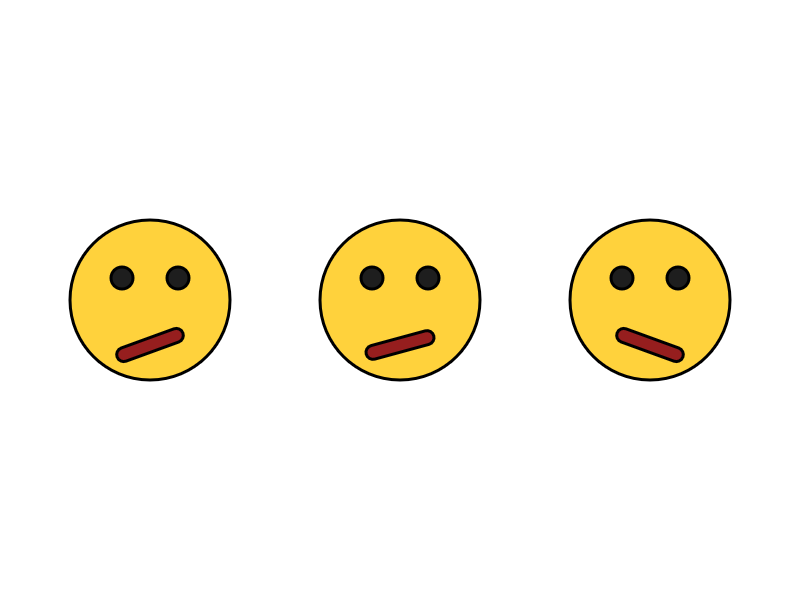

# Project 4: Drawing with functions



A face is a head, two eyes and a mouth: four shapes. A character, a tree or a button is often more. Drawing one is fine, but drawing three means copying the same lines three times, and changing the mouth color means changing it three times. A **function** of your own fixes that: the lines are written once and used as many times as you like, wherever you like.

**You will make:** three faces drawn by one function, each in a different place, and one with a wobbling mouth.

**You will learn:** how to move code into a function, how a function gets the numbers it needs (**parameters**), and why the order of functions in the file matters.

**Time:** about 40 minutes.

**You need:** the CProcessing template, built and running once ([Your first program](Your-first-program)). The face is the one from [Project 3](Project-03-Turning-and-Rounding-Shapes). Do that project first if you haven't, because this one reuses its mouth.

The finished program is in the repository as [examples/projects/04_drawing_functions/main.c](https://github.com/DigiPen-Faculty/CProcessing/blob/main/examples/projects/04_drawing_functions/main.c). The [shapes example](https://github.com/DigiPen-Faculty/CProcessing/blob/main/examples/shapes.c) is full of drawing functions like this one, with parameters for where, how big and how turned: `DrawStar`, `DrawHeart`, `DrawFlag`.

---

## Step 1: The long way

Here is a face, drawn straight in `game_update`. Replace the code in `main.c` with this:

```C
#include "cprocessing.h"

void game_init(void)
{
	CP_System_SetWindowSize(800, 600);
}

void game_update(void)
{
	CP_Graphics_ClearBackground(CP_Color_Create(255, 255, 255, 255));

	// The head
	CP_Settings_Fill(CP_Color_Create(255, 210, 60, 255));
	CP_Graphics_DrawCircle(250.0f, 300.0f, 160.0f);

	// The mouth
	CP_Settings_Fill(CP_Color_Create(150, 30, 30, 255));
	CP_Graphics_DrawRoundedRect(250.0f, 345.0f, 70.0f, 14.0f, 7.0f);

	// The eyes
	CP_Settings_Fill(CP_Color_Create(30, 30, 30, 255));
	CP_Graphics_DrawCircle(222.0f, 278.0f, 22.0f);
	CP_Graphics_DrawCircle(278.0f, 278.0f, 22.0f);
}

void game_exit(void)
{
}

int main(void)
{
	CP_Engine_SetNextGameState(game_init, game_update, game_exit);
	CP_Engine_Run();
	return 0;
}
```

> **Try it:** make a second face by copying the head, mouth and eyes lines and changing every x position to put it on the right side of the window (550 for the head). How many numbers did you have to change? Now change the head color of *both* faces. What would it take to add ten faces?

## Step 2: Move it into a function

A function is a named piece of code. You have been writing them all along: `game_update` is one. A function of your own goes **above** the function that uses it. Take the drawing lines out of `game_update` and put them in `DrawFace`:

```C
#include "cprocessing.h"

void game_init(void)
{
	CP_System_SetWindowSize(800, 600);
}

// Draws a face
void DrawFace(void)
{
	// The head
	CP_Settings_Fill(CP_Color_Create(255, 210, 60, 255));
	CP_Graphics_DrawCircle(250.0f, 300.0f, 160.0f);

	// The mouth
	CP_Settings_Fill(CP_Color_Create(150, 30, 30, 255));
	CP_Graphics_DrawRoundedRect(250.0f, 345.0f, 70.0f, 14.0f, 7.0f);

	// The eyes
	CP_Settings_Fill(CP_Color_Create(30, 30, 30, 255));
	CP_Graphics_DrawCircle(222.0f, 278.0f, 22.0f);
	CP_Graphics_DrawCircle(278.0f, 278.0f, 22.0f);
}

void game_update(void)
{
	CP_Graphics_ClearBackground(CP_Color_Create(255, 255, 255, 255));
	DrawFace();
}

void game_exit(void)
{
}

int main(void)
{
	CP_Engine_SetNextGameState(game_init, game_update, game_exit);
	CP_Engine_Run();
	return 0;
}
```

`void DrawFace(void)` means: a function called `DrawFace` that gives nothing back (`void`) and takes nothing in (`void`). `DrawFace();` is a **call**: it runs the lines inside, then carries on. The picture is the same as before.

> **Try it:** call it twice: `DrawFace(); DrawFace();`. Do you see two faces? Why not? (Both are drawn in the same place.) Take the second call back out.

Now the wrong turn. The computer reads the file from the top, so a function has to be known before it is used.

> **Try it:** cut the whole `DrawFace` function and paste it *below* `game_update`. Build. Read the messages. One says `'DrawFace' undefined; assuming extern returning int`: when `game_update` called `DrawFace`, the computer had never heard of it. Fix it by moving the function back above `game_update`.
>
> There is another fix. Leave the function below, and add this line above `game_update`: `void DrawFace(void);`. That line is called a **prototype**: it tells the computer that `DrawFace` exists, with this shape, and that the full function comes later. Try both, and decide which one you prefer. Programs with many functions, or many files, use prototypes.

## Step 3: Give it numbers

A face that is always at (250, 300) is not much use. The function needs to be told *where*. Numbers that go into a function are **parameters**, written in the parentheses with a type and a name, like the variables you already know:

<!-- no-compile -->
```C
void DrawFace(float x, float y)
{
	// The head
	CP_Settings_Fill(CP_Color_Create(255, 210, 60, 255));
	CP_Graphics_DrawCircle(x, y, 160.0f);

	// The mouth, 45 pixels below the middle of the face
	CP_Settings_Fill(CP_Color_Create(150, 30, 30, 255));
	CP_Graphics_DrawRoundedRect(x, y + 45.0f, 70.0f, 14.0f, 7.0f);

	// The eyes, 28 pixels to each side and 22 pixels up
	CP_Settings_Fill(CP_Color_Create(30, 30, 30, 255));
	CP_Graphics_DrawCircle(x - 28.0f, y - 22.0f, 22.0f);
	CP_Graphics_DrawCircle(x + 28.0f, y - 22.0f, 22.0f);
}
```

Inside the function, `x` and `y` are the middle of the face, and every other part is placed *from* it: the mouth `y + 45` (down), an eye `x - 28` (left). So the whole face moves with `x` and `y`. A call gives the numbers:

<!-- no-compile -->
```C
DrawFace(250.0f, 300.0f);
DrawFace(550.0f, 300.0f);
```

> **Try it:** make that change and see two faces. Now break it on purpose: in the eyes, change `x - 28.0f` and `x + 28.0f` back to the fixed numbers `222.0f` and `278.0f`. Where do the eyes of the second face go? Put it back. A part that doesn't use `x` and `y` doesn't move with the face.

`x` and `y` are copies. Each call gets its own: changing `x` inside the function doesn't change the number you passed in.

## Step 4: Make the faces different

The parameters can be anything the function needs. A third number can set the angle of the mouth, which is the turning from [Project 3](Project-03-Turning-and-Rounding-Shapes), now inside the function, where there is only one place to write it:

```C
#include "cprocessing.h"
#include <math.h>

// Draws a face with its middle at (x, y), and its mouth turned by mouthTilt degrees
void DrawFace(float x, float y, float mouthTilt)
{
	// The head
	CP_Settings_Fill(CP_Color_Create(255, 210, 60, 255));
	CP_Graphics_DrawCircle(x, y, 160.0f);

	// The mouth, turned around its own middle
	CP_Settings_Fill(CP_Color_Create(150, 30, 30, 255));
	CP_Settings_Save();
	CP_Settings_Translate(x, y + 45.0f);
	CP_Settings_Rotate(mouthTilt);
	CP_Graphics_DrawRoundedRect(0.0f, 0.0f, 70.0f, 14.0f, 7.0f);
	CP_Settings_Restore();

	// The eyes
	CP_Settings_Fill(CP_Color_Create(30, 30, 30, 255));
	CP_Graphics_DrawCircle(x - 28.0f, y - 22.0f, 22.0f);
	CP_Graphics_DrawCircle(x + 28.0f, y - 22.0f, 22.0f);
}

void game_init(void)
{
	CP_System_SetWindowSize(800, 600);
}

void game_update(void)
{
	CP_Graphics_ClearBackground(CP_Color_Create(255, 255, 255, 255));

	float wobble = sinf(CP_System_GetSeconds() * 2.0f) * 20.0f;

	DrawFace(150.0f, 300.0f, -20.0f);
	DrawFace(400.0f, 300.0f, wobble);
	DrawFace(650.0f, 300.0f, 20.0f);
}

void game_exit(void)
{
}

int main(void)
{
	CP_Engine_SetNextGameState(game_init, game_update, game_exit);
	CP_Engine_Run();
	return 0;
}
```

The `Save` and `Restore` are inside the function, so the turning of one face can't leak into the next, and the caller never has to think about it.

> **Try it:** change the head color in one place. How many faces change? Then add a fourth face that follows the mouse: `DrawFace(CP_Input_GetMouseX(), CP_Input_GetMouseY(), 0.0f);`. Then give the middle face a mouth that turns the other way.

## Make it yours

Pick two or more.

* Add a parameter for the head color. A color is also a type: `CP_Color skin`, used as `CP_Settings_Fill(skin)`.
* Add a parameter for the size, and place the eyes and mouth from it, so the face can be small or large. (`CP_Settings_Scale` is another way: see [Transforms](Transforms).)
* Draw a row of faces with a loop: `for (int i = 0; i < 5; i++) { DrawFace(100.0f + i * 150.0f, 300.0f, 0.0f); }`.
* Draw something that isn't a face with the same approach: a tree, a car, a house, a robot. What numbers does it need?
* Write a second function that draws a *crowd* by calling `DrawFace` many times with `CP_Random_RangeFloat` positions. Make the numbers once, in `game_init`, or the crowd will flicker. (A function can call another one.)
* Change the face in the function and check that every face changes: this is the reason to have one.

## Check yourself

* What does `void` mean in `void DrawFace(float x, float y)`: the first one, and the one in `game_update(void)`?
* Why did `DrawFace(); DrawFace();` draw only one face?
* What is a parameter? What are the parameters of `DrawFace(float x, float y, float mouthTilt)`?
* Where is the second face's right eye, when it is drawn by `DrawFace(550.0f, 300.0f, 0.0f)`?
* What does a prototype do?

## Common mistakes

* **`undefined; assuming extern returning int`.** The function is used before it is written. Move it above, or add a prototype above.
* **A prototype that doesn't match.** `void DrawFace(float x, float y);` and the function itself have to agree on every type. A different number of parameters is a different function.
* **A part of the drawing stays behind.** It uses fixed numbers instead of `x` and `y`. Every position in the function is `x` or `y` plus or minus something.
* **Two calls in the same place.** The same parameters draw the same picture: change them for each call.
* **Settings that stay set after the function.** A fill color or a turn set inside a function is still set when it ends, so it changes everything drawn after the call. Use `CP_Settings_Save` and `CP_Settings_Restore` inside the function to leave things as they were found.
* **A missing semicolon.** The line `DrawFace(250.0f, 300.0f);` ends with `;`. The function's top line, `void DrawFace(...)`, does *not*, but a prototype does.
* **Old code with `CP_Graphics_DrawRectAdvanced` in the function.** It was removed. See [Updating older code](Updating-older-code).
