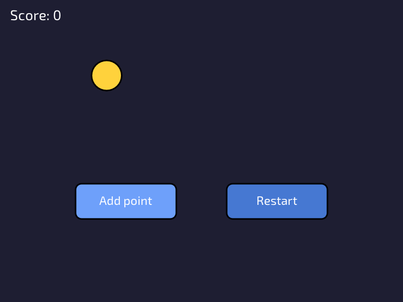

# Project 5: Buttons and restart



A button is a rectangle with a promise: *if you click here, something happens.* Menus, "Play again", "Quit" and "Next" are all buttons. CProcessing has no button function, so you build one from a rectangle, a test for "is the mouse over it", and the right kind of click. Then a button can do the most useful thing of all: start the game over.

**You will make:** a window with a moving ball, a score, an "Add point" button that scores, and a "Restart" button that starts the whole thing over.

**You will learn:** how to tell whether the mouse is over a rectangle, the difference between `MouseTriggered` and `MouseClicked`, how to make your own function that gives back a true or false answer, and how to restart a game state.

**Time:** about 50 minutes.

**You need:** the CProcessing template, built and running once ([Your first program](Your-first-program)), and [Project 4](Project-04-Drawing-with-Functions), whose function and prototype ideas this project uses. Showing the score uses `snprintf` from [Project 2](Project-02-Text-and-Numbers).

The finished program is in the repository as [examples/projects/05_buttons_and_restart/main.c](https://github.com/DigiPen-Faculty/CProcessing/blob/main/examples/projects/05_buttons_and_restart/main.c). [Lesson 6](Lesson-06-Collision) has a button too, and the [mouse example](https://github.com/DigiPen-Faculty/CProcessing/blob/main/examples/mouse.c) has a stricter one to copy (step 3 says how it differs).

---

## Step 1: A button that notices the mouse

A rectangle's position is its **center** by default, so a rectangle at `(400, 300)` that is 200 wide and 80 tall covers x from 300 to 500 and y from 260 to 340. The mouse is over it when its x is between 300 and 500 *and* its y is between 260 and 340. Here that test is a function, and the button changes color when the mouse is over it. Replace the code in `main.c` with this:

```C
#include "cprocessing.h"

// True if the mouse is inside the rectangle with its middle at (x, y)
bool MouseIsInside(float x, float y, float width, float height)
{
	float mouseX = CP_Input_GetMouseX();
	float mouseY = CP_Input_GetMouseY();
	bool insideX = mouseX > x - width / 2.0f && mouseX < x + width / 2.0f;
	bool insideY = mouseY > y - height / 2.0f && mouseY < y + height / 2.0f;
	return insideX && insideY;
}

void game_init(void)
{
	CP_System_SetWindowSize(800, 600);
}

void game_update(void)
{
	CP_Graphics_ClearBackground(CP_Color_Create(30, 30, 50, 255));

	if (MouseIsInside(400.0f, 300.0f, 200.0f, 80.0f))
	{
		CP_Settings_Fill(CP_Color_Create(110, 160, 250, 255));  // light: the mouse is over it
	}
	else
	{
		CP_Settings_Fill(CP_Color_Create(70, 120, 210, 255));
	}
	CP_Graphics_DrawRoundedRect(400.0f, 300.0f, 200.0f, 80.0f, 12.0f);
}

void game_exit(void)
{
}

int main(void)
{
	CP_Engine_SetNextGameState(game_init, game_update, game_exit);
	CP_Engine_Run();
	return 0;
}
```

The `&&` means "and": both sides have to be true. `insideX` is true when the mouse is between the left and right edges, `insideY` when it is between the top and bottom, and the mouse is inside when both are. `bool` is the type for a true or false answer, and `MouseIsInside` is a function that **returns** one.

> **Try it:** move the mouse over the button and off it. Then break the test on purpose: change the `insideX` line to `mouseX > x && mouseX < x + width`, and `insideY` the same way with `y` and `height`, so it covers the area from `(x, y)` to `(x + width, y + height)`. Where does the button light up now? (That would be right for a button drawn from its top left corner. This one is drawn from its middle.) Put it back.

## Step 2: React to a click

`CP_Input_MouseClicked()` is true on the frame the left mouse button is *let go*. A click on the button is "the mouse is over it" **and** "it was just clicked":

<!-- no-compile -->
```C
#include <stdio.h>                         // at the top of the file

int clicks = 0;                            // outside the functions

void game_update(void)
{
	if (MouseIsInside(400.0f, 300.0f, 200.0f, 80.0f) && CP_Input_MouseClicked())
	{
		clicks++;
	}

	// ... the drawing from before, and then:
	char text[50] = { 0 };
	snprintf(text, sizeof(text), "Clicks: %d", clicks);
	CP_Settings_Fill(CP_Color_Create(255, 255, 255, 255));
	CP_Font_DrawText(text, 20.0f, 40.0f);
}
```

(Showing numbers in text is on [Project 2](Project-02-Text-and-Numbers).)

> **Try it:** click the button and watch the count. Now take out the `MouseIsInside(...) &&` part, so only `CP_Input_MouseClicked()` is left. Click somewhere else in the window. A button that reacts when you click *anywhere* is not a button. Put the test back.

## Step 3: Pressed or let go?

There are two ways to ask "was the button clicked": by when the mouse button goes **down**, and by when it comes back **up**.

* `CP_Input_MouseTriggered(CP_MOUSE_LEFT)` is true on the frame the left button goes down.
* `CP_Input_MouseClicked()` is true on the frame the left button is let go.

They feel different. Buttons everywhere in programs you use do their thing when you let go, so that if you press and change your mind, you can slide off the button and let go somewhere else, and nothing happens.

> **Try it:** change `CP_Input_MouseClicked()` to `CP_Input_MouseTriggered(CP_MOUSE_LEFT)`. Press and *hold* on the button: the count goes up the moment you press. Now put it back to `MouseClicked`, press on the button, slide off while still holding, and let go. Does it count? Press and slide back on and let go over it?

`MouseClicked` is the one to use for buttons. (A stricter button counts only if the press *and* the release are both on it. The [mouse example](https://github.com/DigiPen-Faculty/CProcessing/blob/main/examples/mouse.c) has that recipe, `DoButton`, to copy when you want it. This project's function is called `Button`, so the two don't get mixed up: they work differently, and `DoButton` places its button by the top left corner.)

## Step 4: A function for a button

A game has several buttons, and each one needs the drawing, the color change and the click test. Put them in a function that draws a button and *answers* "was it clicked?":

<!-- no-compile -->
```C
// Draws a button with its middle at (x, y). Returns true on the frame it's clicked
bool Button(const char* label, float x, float y, float width, float height)
{
	bool over = MouseIsInside(x, y, width, height);

	CP_Settings_Save();   // so the colors and text settings below don't leak out

	if (over)
	{
		CP_Settings_Fill(CP_Color_Create(110, 160, 250, 255));
	}
	else
	{
		CP_Settings_Fill(CP_Color_Create(70, 120, 210, 255));
	}
	CP_Graphics_DrawRoundedRect(x, y, width, height, 12.0f);

	CP_Settings_Fill(CP_Color_Create(255, 255, 255, 255));
	CP_Settings_TextSize(24.0f);
	CP_Settings_TextAlignment(CP_TEXT_ALIGN_H_CENTER, CP_TEXT_ALIGN_V_MIDDLE);
	CP_Font_DrawText(label, x, y);

	CP_Settings_Restore();

	return over && CP_Input_MouseClicked();
}
```

`return` hands the answer back to whoever called the function. Now each button is one `if`:

<!-- no-compile -->
```C
if (Button("Add point", 250.0f, 400.0f, 200.0f, 70.0f))
{
	score++;
}
```

The call draws the button, *and* its answer decides whether the lines in the braces run.

> **Try it:** make a third button with its own label and position. What would it take to make a hundred by hand, compared with a function?

## Step 5: Restart

To start a game over, run its `game_init` again and carry on. `CP_Engine_SetNextGameStateForced` does that: it leaves the current state (calling `game_exit`), then starts the state named in the call, which here is the same one (calling `game_init` again). The program that follows has a ball that moves, a score, and the two buttons:

```C
#include "cprocessing.h"
#include <stdio.h>

void game_exit(void);   // a prototype: game_update uses game_exit before it is written

int score;
float ballX;

// True if the mouse is inside the rectangle with its middle at (x, y)
bool MouseIsInside(float x, float y, float width, float height)
{
	float mouseX = CP_Input_GetMouseX();
	float mouseY = CP_Input_GetMouseY();
	bool insideX = mouseX > x - width / 2.0f && mouseX < x + width / 2.0f;
	bool insideY = mouseY > y - height / 2.0f && mouseY < y + height / 2.0f;
	return insideX && insideY;
}

// Draws a button with its middle at (x, y). Returns true on the frame it's clicked
bool Button(const char* label, float x, float y, float width, float height)
{
	bool over = MouseIsInside(x, y, width, height);

	CP_Settings_Save();
	if (over)
	{
		CP_Settings_Fill(CP_Color_Create(110, 160, 250, 255));
	}
	else
	{
		CP_Settings_Fill(CP_Color_Create(70, 120, 210, 255));
	}
	CP_Graphics_DrawRoundedRect(x, y, width, height, 12.0f);

	CP_Settings_Fill(CP_Color_Create(255, 255, 255, 255));
	CP_Settings_TextSize(24.0f);
	CP_Settings_TextAlignment(CP_TEXT_ALIGN_H_CENTER, CP_TEXT_ALIGN_V_MIDDLE);
	CP_Font_DrawText(label, x, y);
	CP_Settings_Restore();

	return over && CP_Input_MouseClicked();
}

void game_init(void)
{
	CP_System_SetWindowSize(800, 600);
	score = 0;
	ballX = 100.0f;
}

void game_update(void)
{
	ballX += 100.0f * CP_System_GetDt();   // 100 pixels per second

	CP_Graphics_ClearBackground(CP_Color_Create(30, 30, 50, 255));

	CP_Settings_Fill(CP_Color_Create(255, 210, 60, 255));
	CP_Graphics_DrawCircle(ballX, 150.0f, 60.0f);

	char text[50] = { 0 };
	snprintf(text, sizeof(text), "Score: %d", score);
	CP_Settings_Fill(CP_Color_Create(255, 255, 255, 255));
	CP_Settings_TextSize(28.0f);
	CP_Font_DrawText(text, 20.0f, 40.0f);

	if (Button("Add point", 250.0f, 400.0f, 200.0f, 70.0f))
	{
		score++;
	}

	if (Button("Restart", 550.0f, 400.0f, 200.0f, 70.0f))
	{
		CP_Engine_SetNextGameStateForced(game_init, game_update, game_exit);
	}
}

void game_exit(void)
{
}

int main(void)
{
	CP_Engine_SetNextGameState(game_init, game_update, game_exit);
	CP_Engine_Run();
	return 0;
}
```

`score` and `ballX` are set in `game_init`, which runs again at each restart, so the game starts over from the start.

Three things to try, each one a thing that goes wrong:

> **Try it:** delete the `void game_exit(void);` line at the top and build. The message says `'game_exit': undeclared identifier`, because `game_update` names `game_exit` before the computer has seen it. That is the same problem as in [Project 4](Project-04-Drawing-with-Functions), and the prototype is one of the two ways out. What is the other one? Put the line back.
>
> Change `CP_Engine_SetNextGameStateForced` to `CP_Engine_SetNextGameState`. Click Restart. Nothing happens: asking for the state you are already in does nothing, and `Forced` is the one that leaves it and enters it again. CProcessing also prints a message saying so ([Messages from CProcessing](Debugging#messages-from-cprocessing)).
>
> In `game_init`, delete the `score = 0;` line and give the variable its start up top instead: `int score = 0;`. Score a few points, then click Restart. The score stays. A start written where the variable is made happens **once**, when the program starts. A start written in `game_init` happens **every time the state starts**, which is what a restart needs. Put it back.

## Make it yours

Pick two or more.

* Make Restart a different color from Add point, or give it a symbol.
* Make the Add point button *hard*: it moves to a random place, with [CP_Random_RangeFloat](Random/#CP_Random_RangeFloat), every time it is clicked. The place has to be kept in variables, set in `game_init`, so that it doesn't jump every frame.
* Make the ball bounce back when it hits the edge of the window, and speed up with the score.
* Draw the whole game only while `score` is below 10, then show "You win!" and *only* the Restart button.
* Add a Quit button that calls `CP_Engine_Terminate()`.
* Press **R** for restart too: `CP_Input_KeyTriggered(CP_KEY_R)`.
* A button that is *disabled* until the score is 5: draw it grey and make its click do nothing.

## Check yourself

* What does the mouse need to be doing for `MouseIsInside` to return true?
* When is `CP_Input_MouseClicked()` true? When is `CP_Input_MouseTriggered(CP_MOUSE_LEFT)` true?
* Why do buttons usually act when you let go instead of when you press?
* What does `return over && CP_Input_MouseClicked();` give back, and when?
* Why does restarting need `Forced`? Why does `score = 0;` belong in `game_init` and not up with the variable?

## Common mistakes

* **The button reacts to a click anywhere.** The click test has to be joined with `MouseIsInside(...) &&`.
* **The button reacts in the wrong place.** The rectangle's position is its *middle*, not its corner. Test from `x - width / 2` to `x + width / 2`.
* **The button fires many times.** `MouseDown` is true for as long as the button is held, which is many frames. Use `MouseClicked`, or `MouseTriggered`, which are true for one frame.
* **Restart does nothing.** Use `CP_Engine_SetNextGameStateForced` for the state you are already in.
* **Restart keeps the old score.** The start is written where the variable is made, so it only runs once. Set the start in `game_init`.
* **`'game_exit': undeclared identifier`.** A function is named before it is written. Add a prototype above, or move the function up.
* **Text and colors changed for everything afterwards.** A function that sets the fill color or the text alignment changes it for the rest of the frame. `CP_Settings_Save` at the start of the function and `CP_Settings_Restore` at the end put it all back.
* **`CP_Engine_SetNextGamestateForced` doesn't compile.** C cares about capital letters: the name has a capital S in `GameState`.
