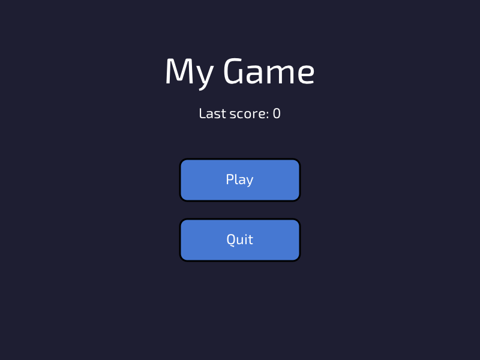

# Project 6: A game in many files



A game with a splash screen, a menu and a level in a single file is hard to read and harder to share: everything scrolls past, and two people can't edit it at once. Real programs are split into **files**, one for each part. In CProcessing the natural split is one file for each *game state* (see [Game states](Game-states)): a splash screen, a menu, the game.

This project builds a small game that way: a splash screen that moves on by itself, a menu with buttons, and a ten-second game that keeps a score the menu can show. It teaches the part that surprises people, which is how files find each other.

**You will make:** a program of three screens, each in its own files: a splash that goes to the menu after two seconds, a menu with Play and Quit buttons, and a game of clicking targets. The menu shows your last score, and Escape quits from anywhere.

**You will learn:** what a header file is, how to add files to a project, how one file uses another's functions, how to share data between files, and how to quit.

**Time:** about 75 minutes.

**You need:** the CProcessing template, built and running once ([Your first program](Your-first-program)), [Project 4](Project-04-Drawing-with-Functions) (prototypes) and [Project 5](Project-05-Buttons-and-Restart) (the buttons used here). [Game states](Game-states) explains what a game state is.

The finished program is in the repository as the folder [examples/projects/06_many_files](https://github.com/DigiPen-Faculty/CProcessing/tree/main/examples/projects/06_many_files): nine files, with a note at the top of its `main.c` on how to run them. [Lesson 9](Lesson-09-Game-States) builds a game with states in one file, and adds a pause on top of the game.

---

## Step 1: Two files for one idea

A game state is three functions: init, update and exit. Put the three of a state in a **.c file**, and put their *names* in a matching **.h file**, called a **header**. The header is the list of what the .c file offers to the rest of the program: the prototypes you met in [Project 4](Project-04-Drawing-with-Functions), kept somewhere other files can read. The names follow one pattern: `gamestate_splash.c` and `gamestate_splash.h` hold `gamestate_splash_init`, `gamestate_splash_update` and `gamestate_splash_exit`.

You end up with these files, next to `main.c`:

| File | Holds |
|---|---|
| `main.c` | `main`, and the function that quits on Escape |
| `gamestate_splash.c` and `.h` | the splash screen |
| `gamestate_menu.c` and `.h` | the menu |
| `gamestate_play.c` and `.h` | the game |
| `score.c` and `.h` | the score, which the game and the menu share |

Starting a state means adding a new pair of files. The templates include a blank pair, `gamestate_template.c` and `gamestate_template.h`, next to `main.c`, to copy and rename. (They are not in the project, so they are not built until you add a copy.) The steps below give all the code each file needs.

## Step 2: The first state

Make the pair for the splash screen.

**In Visual Studio,** the copying, renaming and adding all happen in one window:

1. Right-click the project in Solution Explorer, then *Add*, *Existing Item*. A file window opens on the project folder.
2. Click `gamestate_template.c`, then Ctrl+click `gamestate_template.h`, so both are selected. Press Ctrl+C, then Ctrl+V. Two copies appear, still selected: `gamestate_template - Copy.c` and `gamestate_template - Copy.h`.
3. Press F2, type `gamestate_splash` and press Enter. Both copies get the new name, and each keeps its own `.c` or `.h`.
4. Select the two new files and click *Add*. They appear in Solution Explorer.
5. The names *inside* the files still say `template`. Open each of the two, press Ctrl+H (*Replace*), replace `template` with `splash`, and choose *Replace All*. It changes only the open file, so do it in both.

**With CMake:** copy the two files in File Explorer and rename them the same way (Ctrl+C, Ctrl+V, F2), then replace `template` with `splash` inside them in your editor. Every `.c` file next to `main.c` is built, apart from `gamestate_template.c` itself, so there is nothing to add.

Fill in your name, and what the state does, in the comment at the top of each file.

The header now holds the three names (under the comment at the top):

<!-- no-compile -->
```C
// gamestate_splash.h
#pragma once

void gamestate_splash_init(void);
void gamestate_splash_update(void);
void gamestate_splash_exit(void);
```

`#pragma once` makes sure the header is only read once, even if several files include it.

Fill in `gamestate_splash_update` in `gamestate_splash.c`, so that it shows the game's name (the comments from the blank are left out here):

<!-- no-compile -->
```C
// gamestate_splash.c
#include "cprocessing.h"
#include "gamestate_splash.h"

void gamestate_splash_init(void)
{
}

void gamestate_splash_update(void)
{
	CP_Graphics_ClearBackground(CP_Color_Create(20, 20, 30, 255));

	CP_Settings_Fill(CP_Color_Create(255, 255, 255, 255));
	CP_Settings_TextSize(60.0f);
	CP_Settings_TextAlignment(CP_TEXT_ALIGN_H_CENTER, CP_TEXT_ALIGN_V_MIDDLE);
	CP_Font_DrawText("My Game", CP_System_GetWindowWidth() / 2.0f, CP_System_GetWindowHeight() / 2.0f);
}

void gamestate_splash_exit(void)
{
}
```

`#include "gamestate_splash.h"`, in quotes, reads one of your own files. The angle brackets of `<stdio.h>` are for files that come with the compiler. `#include "cprocessing.h"` is in quotes too, because it comes with the template.

`main.c` now has only `main`, which includes the header and starts the splash state. Replace everything in it with:

<!-- no-compile -->
```C
// main.c
#include "cprocessing.h"
#include "gamestate_splash.h"

int main(void)
{
	CP_System_SetWindowSize(800, 600);
	CP_Engine_SetNextGameState(gamestate_splash_init, gamestate_splash_update, gamestate_splash_exit);
	CP_Engine_Run();
	return 0;
}
```

Build and run. You see "My Game", and it stays.

> **Try it:** a file that exists isn't always part of the program. Take `gamestate_splash.c` out of the build: in Visual Studio right-click it and choose *Remove* (it stays on the disk); with CMake, move it to another folder. Build. The message is `unresolved external symbol gamestate_splash_init referenced in function main`. The header *promised* the function, and nothing provided it. This error is called a **linker error**, and it nearly always means a file isn't in the project. Put the file back.

## Step 3: A second state, and moving on by itself

Make the menu pair the same way, from the blank pair, named `gamestate_menu`. Its update draws "Menu" for now:

<!-- no-compile -->
```C
// gamestate_menu.h
#pragma once

void gamestate_menu_init(void);
void gamestate_menu_update(void);
void gamestate_menu_exit(void);
```

<!-- no-compile -->
```C
// gamestate_menu.c
#include "cprocessing.h"
#include "gamestate_menu.h"

void gamestate_menu_init(void)
{
}

void gamestate_menu_update(void)
{
	CP_Graphics_ClearBackground(CP_Color_Create(30, 30, 50, 255));
	CP_Settings_Fill(CP_Color_Create(255, 255, 255, 255));
	CP_Settings_TextAlignment(CP_TEXT_ALIGN_H_CENTER, CP_TEXT_ALIGN_V_MIDDLE);
	CP_Font_DrawText("Menu", 400.0f, 120.0f);
}

void gamestate_menu_exit(void)
{
}
```

Now the splash moves on after two seconds. [CP_Engine_GetGameStateTime](Engine/#CP_Engine_GetGameStateTime) is the seconds since this state started. In `gamestate_splash.c`, add the line `#include "gamestate_menu.h"` at the top, and this at the end of `gamestate_splash_update`:

<!-- no-compile -->
```C
	// After two seconds in this state, go to the menu
	if (CP_Engine_GetGameStateTime() > 2.0f)
	{
		CP_Engine_SetNextGameState(gamestate_menu_init, gamestate_menu_update, gamestate_menu_exit);
	}
```

Build and run: "My Game", and two seconds later, "Menu".

> **Try it:** take the `#include "gamestate_menu.h"` line out of `gamestate_splash.c`. Build. The error says `'gamestate_menu_init': undeclared identifier`. Each file knows only its own names, and the names in the headers it includes. The splash file never heard of the menu. Put the line back.

## Step 4: Buttons, and a way out

Replace `gamestate_menu.c` with a menu that has a button that quits. The two helper functions are the ones from [Project 5](Project-05-Buttons-and-Restart):

<!-- no-compile -->
```C
// gamestate_menu.c
#include "cprocessing.h"
#include "gamestate_menu.h"

// True if the mouse is inside the rectangle with its middle at (x, y)
static bool MouseIsInside(float x, float y, float width, float height)
{
	float mouseX = CP_Input_GetMouseX();
	float mouseY = CP_Input_GetMouseY();
	bool insideX = mouseX > x - width / 2.0f && mouseX < x + width / 2.0f;
	bool insideY = mouseY > y - height / 2.0f && mouseY < y + height / 2.0f;
	return insideX && insideY;
}

// Draws a button with its middle at (x, y). Returns true on the frame it's clicked
static bool Button(const char* label, float x, float y, float width, float height)
{
	bool over = MouseIsInside(x, y, width, height);

	CP_Settings_Save();
	if (over)
	{
		CP_Settings_Fill(CP_Color_Create(110, 160, 250, 255));
	}
	else
	{
		CP_Settings_Fill(CP_Color_Create(70, 120, 210, 255));
	}
	CP_Graphics_DrawRoundedRect(x, y, width, height, 12.0f);

	CP_Settings_Fill(CP_Color_Create(255, 255, 255, 255));
	CP_Settings_TextSize(24.0f);
	CP_Settings_TextAlignment(CP_TEXT_ALIGN_H_CENTER, CP_TEXT_ALIGN_V_MIDDLE);
	CP_Font_DrawText(label, x, y);
	CP_Settings_Restore();

	return over && CP_Input_MouseClicked();
}

void gamestate_menu_init(void)
{
}

void gamestate_menu_update(void)
{
	CP_Graphics_ClearBackground(CP_Color_Create(30, 30, 50, 255));

	CP_Settings_Fill(CP_Color_Create(255, 255, 255, 255));
	CP_Settings_TextAlignment(CP_TEXT_ALIGN_H_CENTER, CP_TEXT_ALIGN_V_MIDDLE);
	CP_Settings_TextSize(60.0f);
	CP_Font_DrawText("My Game", 400.0f, 120.0f);

	if (Button("Quit", 400.0f, 400.0f, 200.0f, 70.0f))
	{
		CP_Engine_Terminate();
	}
}

void gamestate_menu_exit(void)
{
}
```

**`static`** in front of a function means *only this file can use it*. The helpers belong to the menu, and another file can have its own `Button` without the two clashing. It also keeps them out of the header. [CP_Engine_Terminate](Engine/#CP_Engine_Terminate) ends the program after the current frame.

A program should also be quick to leave, from any screen, without a Quit button. [CP_Engine_SetPreUpdateFunction](Engine/#CP_Engine_SetPreUpdateFunction) names a function that runs every frame, *before* whichever state is running. Add one to `main.c`:

<!-- no-compile -->
```C
// main.c
#include "cprocessing.h"
#include "gamestate_splash.h"

// Runs every frame, before whichever state is running
void PreUpdate(void)
{
	if (CP_Input_KeyTriggered(CP_KEY_ESCAPE))
	{
		CP_Engine_Terminate();
	}
}

int main(void)
{
	CP_System_SetWindowSize(800, 600);
	CP_Engine_SetNextGameState(gamestate_splash_init, gamestate_splash_update, gamestate_splash_exit);
	CP_Engine_SetPreUpdateFunction(PreUpdate);
	CP_Engine_Run();
	return 0;
}
```

> **Try it:** press Escape on the splash screen, and then on the menu. Click Quit. Then try making `PreUpdate` do something else every frame in every state, such as drawing a small frame count in a corner ([CP_Engine_SetPostUpdateFunction](Engine/#CP_Engine_SetPostUpdateFunction) runs *after* the state, so it draws on top).

## Step 5: Data that two files need

A game state's variables belong to its file. But the score is needed by the game, which changes it, and by the menu, which shows it. Where does it live?

In a file of its own, with a small set of functions to read and change it. Make `score.h` and `score.c`:

<!-- no-compile -->
```C
// score.h
#pragma once

int GetScore(void);
void SetScore(int newScore);
void IncrementScore(void);
```

<!-- no-compile -->
```C
// score.c
#include "score.h"

// static: only the functions in this file can see the variable
static int score = 0;

int GetScore(void)
{
	return score;
}

void SetScore(int newScore)
{
	score = newScore;
}

void IncrementScore(void)
{
	score++;
}
```

The variable is `static`, so *only* these three functions can touch it. Everyone else asks: a function that **gets** a value is a *getter*, one that **sets** it is a *setter*. The advantage: the score can only change in ways you allowed, and when the game has a bug in the score, there are only three places to look.

> **Try it:** in any other file, in the `gamestate_menu_update` function, write `score++;` and build. The message says `'score': undeclared identifier`: the variable is private to `score.c`. Use `IncrementScore();` instead, and then delete the line.

## Step 6: The game, and the whole program

The last state: ten seconds to click targets. Make `gamestate_play.h` the same way as the others:

<!-- no-compile -->
```C
// gamestate_play.h
#pragma once

void gamestate_play_init(void);
void gamestate_play_update(void);
void gamestate_play_exit(void);
```

<!-- no-compile -->
```C
// gamestate_play.c
#include "cprocessing.h"
#include <stdio.h>
#include "gamestate_play.h"
#include "gamestate_menu.h"
#include "score.h"

static const float targetSize = 60.0f;
static float timeLeft;
static CP_Vector target;

static void MoveTarget(void)
{
	float half = targetSize / 2.0f;
	target.x = CP_Random_RangeFloat(half, CP_System_GetWindowWidth() - half);
	target.y = CP_Random_RangeFloat(80.0f + half, CP_System_GetWindowHeight() - half);
}

void gamestate_play_init(void)
{
	SetScore(0);
	timeLeft = 10.0f;
	MoveTarget();
}

void gamestate_play_update(void)
{
	timeLeft -= CP_System_GetDt();
	if (timeLeft <= 0.0f)
	{
		CP_Engine_SetNextGameState(gamestate_menu_init, gamestate_menu_update, gamestate_menu_exit);
	}

	CP_Vector mouse = CP_Vector_Set(CP_Input_GetMouseX(), CP_Input_GetMouseY());
	if (CP_Input_MouseTriggered(CP_MOUSE_LEFT) && CP_Vector_Distance(mouse, target) <= targetSize / 2.0f)
	{
		IncrementScore();
		MoveTarget();
	}

	CP_Graphics_ClearBackground(CP_Color_Create(30, 70, 40, 255));

	CP_Settings_Fill(CP_Color_Create(230, 80, 60, 255));
	CP_Graphics_DrawCircle(target.x, target.y, targetSize);

	char text[50] = { 0 };
	snprintf(text, sizeof(text), "Score: %d   Time: %.1f", GetScore(), timeLeft);
	CP_Settings_Fill(CP_Color_Create(255, 255, 255, 255));
	CP_Settings_TextSize(28.0f);
	CP_Settings_TextAlignment(CP_TEXT_ALIGN_H_LEFT, CP_TEXT_ALIGN_V_TOP);
	CP_Font_DrawText(text, 20.0f, 20.0f);
}

void gamestate_play_exit(void)
{
}
```

Here the click uses `MouseTriggered`: a game of quick taps should react the instant you press, not when you let go. A *button* is different: see [Project 5](Project-05-Buttons-and-Restart).

The game state includes `gamestate_menu.h` so it can go back to the menu, and the menu will include `gamestate_play.h` so it can start the game. That works: each header only lists names, so two files can include each other's headers.

In `gamestate_menu.c`, add these three lines to the includes:

<!-- no-compile -->
```C
#include <stdio.h>
#include "gamestate_play.h"
#include "score.h"
```

and these to `gamestate_menu_update`, after the title and before the Quit button:

<!-- no-compile -->
```C
	char text[50] = { 0 };
	CP_Settings_TextSize(24.0f);
	snprintf(text, sizeof(text), "Last score: %d", GetScore());
	CP_Font_DrawText(text, 400.0f, 190.0f);

	if (Button("Play", 400.0f, 300.0f, 200.0f, 70.0f))
	{
		CP_Engine_SetNextGameState(gamestate_play_init, gamestate_play_update, gamestate_play_exit);
	}
```

Build and run. The splash, the menu, Play, ten seconds of targets, and back to the menu with your score. Escape quits from anywhere.

> **Try it:** what does "Last score" show before you have played? (`score` started at 0.) Play twice with different scores: does the menu show the latest one? Where is the score set back to 0, and what would go wrong if that line were missing?

## Make it yours

Pick two or more.

* **A fourth state: game over.** When time runs out, go to a state that shows the final score and has a Play again button and a Menu button, before the menu. Make the pair, add it to the project, and decide which file includes which header.
* Replace the splash's text with the logo from [Project 1](Project-01-Splash-Screen): the logo's own code goes in `gamestate_splash.c`.
* Keep a best score in `score.c` with `GetBestScore`, so the menu shows the best of all games.
* Move `MouseIsInside` and `Button` into a pair of their own, `ui.c` and `ui.h` (not `static` any more, with their prototypes in the header), so every state can have buttons.
* A Pause: press P in the game to freeze it (see [Game states](Game-states) for a pushed state).
* Add a state before the menu that asks for something, such as a name or a difficulty, and keep the answer in a file of its own, as the score is.

## Check yourself

* What does a header file hold, and what holds the code?
* What does `#pragma once` do? What is the difference between `#include "x.h"` and `#include <x.h>`?
* What does a *linker error* such as `unresolved external symbol` usually mean? What does `undeclared identifier` mean?
* What does `static` in front of a variable or function mean?
* Why does the score have a getter and a setter instead of being a plain global variable that every file uses?
* When does a function named in `CP_Engine_SetPreUpdateFunction` run?

## Common mistakes

* **`unresolved external symbol`.** A file isn't part of the project, or a function is declared in a header but never written. In Visual Studio, right-click the project, *Add*, *Existing Item*. With CMake, check the file is next to `main.c` and build again.
* **`undeclared identifier` for a function from another file.** The file is missing `#include` for that function's header.
* **The header and the code disagree.** If `gamestate_menu.h` says `void gamestate_menu_update(void);` the .c file has to match exactly, including the `(void)`.
* **Putting code in a header.** A header lists names (prototypes). Functions with bodies go in the .c file, or the program has two copies of them.
* **The new state doesn't start.** `CP_Engine_SetNextGameState` needs all three names, with the right spelling: `init`, `update`, `exit`, and `NULL` for one that isn't needed.
* **A shared variable that is a plain global.** Any file can change it, so a wrong score could come from anywhere, and two files that each write `int score;` either fail to build or quietly share one variable, depending on the compiler. Keep it in one file and share a getter and setter.
* **Escape does nothing.** `CP_Engine_SetPreUpdateFunction(PreUpdate);` is missing from `main`, or it was written after `CP_Engine_Run()`, which never returns until the program ends.
